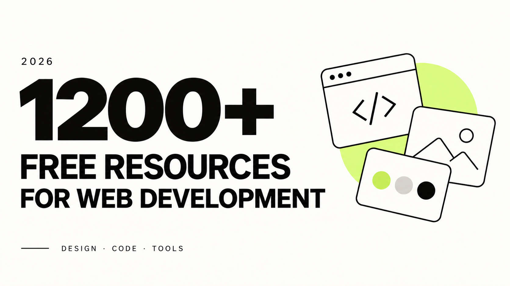

# 🚀 1200+ Free Resources For Web Development (2026) 🤯🤩

A collection of design assets, interface libraries, and tools for web development. All links were checked for accessibility as of October 22, 2026.

## Table of Contents

- [UI Graphics](#ui-graphics)
- [Fonts](#fonts)
- [Colors](#colors)
- [Icons](#icons)
- [Logos](#logos)
- [Favicons](#favicons)
- [Icon Fonts](#icon-fonts)
- [Stock Photos](#stock-photos)
- [Stock Videos](#stock-videos)
- [Stock Music & Sound Effects](#stock-music--sound-effects)
- [Vectors & Clip Art](#vectors--clip-art)
- [Product & Image Mockups](#product--image-mockups)
- [HTML & CSS Templates](#html--css-templates)
- [CSS Frameworks](#css-frameworks)
- [CSS Methodologies](#css-methodologies)
- [CSS Animations](#css-animations)
- [Javascript Animation Libraries](#javascript-animation-libraries)
- [Javascript Chart Libraries](#javascript-chart-libraries)
- [UI Components & Kits](#ui-components--kits)
- [React UI Libraries](#react-ui-libraries)
- [Vue UI Libraries](#vue-ui-libraries)
- [Angular UI Libraries](#angular-ui-libraries)
- [Svelte UI Libraries](#svelte-ui-libraries)
- [React Native UI Libraries](#react-native-ui-libraries)
- [Design Systems & Style Guides](#design-systems--style-guides)
- [Online Design Tools](#online-design-tools)
- [Downloadable Design Software](#downloadable-design-software)
- [Design Inspiration](#design-inspiration)
- [Image Compression](#image-compression)
- [Image Format Conversion](#image-format-conversion)
- [Chrome Extensions](#chrome-extensions)
- [Firefox Extensions](#firefox-extensions)
- [AI Graphic Design Tools](#ai-graphic-design-tools)
- [Others](#others)

## UI Graphics

> Illustrations, patterns, avatars, and graphics for user interfaces.

| Website | Description |
| --- | --- |
| [SVG sine waves](<https://www.sinwaver.com/>) | Generate sine-wave shapes and export them as SVG. |
| [UI Design Daily](<https://www.uidesigndaily.com/>) | Interface design examples and downloadable UI components. |
| [100 Daily UI](<https://100dailyui.webflow.io/>) | A Figma resource collection with interface elements and screens. |
| [Sketch App Sources](<https://www.sketchappsources.com/>) | Sketch files, UI kits, wireframes, and design assets. |
| [Humaaans](<https://www.humaaans.com/>) | Mix-and-match character illustrations for interface and editorial projects. |
| [Paaatterns](<https://products.ls.graphics/paaatterns/>) | Pattern collections for website backgrounds and visual designs. |
| [Drawkit.io](<https://www.drawkit.com/>) | Illustration collections for websites, applications, and presentations. |
| [Absurd.design](<https://absurd.design/>) | Surreal hand-drawn illustrations for digital projects. |
| [Undraw.co](<https://undraw.co/>) | Illustration collections for websites, applications, and presentations. |
| [Manypixels.co](<https://www.manypixels.co/gallery>) | Illustration collections for websites, applications, and presentations. |
| [Open Peeps](<https://www.openpeeps.com/>) | Hand-drawn character illustrations for creative projects. |
| [Open Doodles](<https://www.opendoodles.com/>) | Hand-drawn character illustrations for creative projects. |
| [Blush](<https://blush.design/>) | Compose and customize illustrations from artist-created collections. |
| [Hero Patterns](<https://heropatterns.com/>) | Pattern collections for website backgrounds and visual designs. |
| [BEAUBUS Patterns](<https://patterns.beaubus.com/>) | Pattern collections for website backgrounds and visual designs. |
| [IRA Design](<https://iradesign.io/>) | Customize illustration colors and combine vector elements. |
| [Transparent Textures](<https://www.transparenttextures.com/>) | Transparent texture patterns for layered backgrounds. |
| [icons8.com/illustrations](<https://icons8.com/illustrations>) | Illustration packs in multiple styles for interface projects. |
| [Patternico](<https://patternico.com/>) | Generate decorative patterns and backgrounds for web designs. |
| [Pixeltrue Illustrations](<https://www.pixeltrue.com/packs>) | Illustration collections for websites, applications, and presentations. |
| [Abstract User Avatar API](<https://www.abstractapi.com/api/user-avatar-api>) | Generate abstract avatars for users and demo profiles. |
| [sketchvalley](<https://sketchvalley.com/>) | Illustration collections for websites, applications, and presentations. |
| [PatternPad](<https://patternpad.com/>) | Generate decorative patterns and backgrounds for web designs. |
| [Dimensions](<https://www.dimensions.com/>) | Reference drawings and measurements for objects and spaces. |
| [Freebiesbug](<https://freebiesbug.com/>) | Download interface assets, templates, and design resources. |
| [Cool Text](<https://cooltext.com/>) | Generate stylized text graphics and logo lettering. |
| [illustration kit](<https://illustrationkit.com/>) | Illustration collections for websites, applications, and presentations. |
| [Doodad Pattern Generator](<https://doodad.dev/pattern-generator/>) | Generate decorative patterns and backgrounds for web designs. |
| [Pattern Monster](<https://pattern.monster/>) | Generate decorative patterns and backgrounds for web designs. |
| [Exemplar](<https://themeselection.com/products/exemplar-free-avatar-library-for-figma-and-sketch/>) | An avatar library for use in interface mockups. |
| [UIBundle](<https://uibundle.com/>) | Download interface assets, templates, and design resources. |
| [Design Stripe](<https://visual.app/assets>) | Editable illustration assets for visual projects. |
| [HOLA SVG!](<https://holasvg.com/>) | SVG graphics and resources for web design. |
| [symu.co](<https://symu.co/freebies/templates-4/>) | Download interface assets, templates, and design resources. |
| [Mesh Gradient](<https://meshgradient.in/>) | Create mesh-gradient backgrounds with adjustable colors. |
| [CSS Shadow Gradients](<https://alvarotrigo.com/shadow-gradients/>) | Generate shadow and gradient styles for interfaces. |
| [Creatica](<https://creatica.app/backgrounds>) | Generate decorative patterns and backgrounds for web designs. |
| [Boring Avatars](<https://boringavatars.com/>) | Generate abstract avatars for users and demo profiles. |
| [Html to Design](<https://www.figma.com/community/plugin/1159123024924461424/html-to-design-by-divriots-import-websites-to-figma-designs-web-html-css>) | Import website layouts into Figma for editing. |
| [fffuel](<https://www.fffuel.co/>) | A collection of SVG generators for patterns, shapes, and backgrounds. |
| [Mesher](<https://csshero.org/mesher/>) | Create mesh-gradient backgrounds with adjustable colors. |
| [DiceBear](<https://www.dicebear.com/>) | Generate customizable SVG avatars from repeatable text seeds. |
| [SVG Backgrounds](<https://www.svgbackgrounds.com/>) | Customize SVG backgrounds and decorative patterns for websites. |

## Fonts

> Font libraries and tools for choosing, pairing, and using typefaces.

| Website | Description |
| --- | --- |
| [Google Fonts](<https://fonts.google.com/>) | Browse font families for web use and self-hosted typography. |
| [DaFont](<https://www.dafont.com/>) | Browse and download fonts across a range of styles. |
| [Use &amp; Modify](<https://usemodify.com/>) | A curated collection of open-source typefaces. |
| [1001 Free Fonts](<https://www.1001freefonts.com/>) | Browse and download fonts across a range of styles. |
| [Font Squirrel](<https://www.fontsquirrel.com/>) | Browse and download fonts across a range of styles. |
| [Font Fabric](<https://www.fontfabric.com/free-fonts/>) | Typeface collections from independent type designers and foundries. |
| [Just Free Fonts](<https://justfreefonts.com/>) | Browse and download fonts across a range of styles. |
| [Tiff](<https://winniethemu.github.io/tiff/>) | Compare the shapes and details of different typefaces. |
| [TypeKit Practice](<https://practice.typekit.com/>) | Typography resources, examples, and learning material. |
| [Fontjoy](<https://fontjoy.com/>) | Explore font pairings for headings and body text. |
| [Golden Ratio](<https://grtcalculator.com/>) | Calculate typography sizes and spacing using proportional scales. |
| [FontGet](<https://www.fontget.com/>) | Browse and download fonts across a range of styles. |
| [FontPair](<https://fontpair.co/>) | Explore font pairings for headings and body text. |
| [Font Space](<https://www.fontspace.com/>) | Browse and download fonts across a range of styles. |
| [Abstract Fonts](<https://www.abstractfonts.com/>) | Browse and download fonts across a range of styles. |
| [Free Typography](<https://freetypography.com/>) | Typography resources, examples, and learning material. |
| [Leon Sans](<https://github.com/cmiscm/leonsans/>) | A geometric typeface with programmable drawing and animation. |
| [Lexend](<https://www.lexend.com/>) | A font family developed with reading readability in mind. |
| [Fonts for Apple Platforms](<https://developer.apple.com/fonts/>) | Apple typography resources and platform font downloads. |
| [SFWin](<https://github.com/aishalih/sfwin>) | Resources for using San Francisco fonts on Windows. |
| [Font Flipper](<https://fontflipper.com/>) | Explore font pairings for headings and body text. |
| [Fonts Arena](<https://fontsarena.com/>) | Browse and download fonts across a range of styles. |
| [Befonts](<https://befonts.com/>) | Browse and download fonts across a range of styles. |
| [Arabic fonts](<https://arabicfonts.net/>) | Arabic typefaces for digital typography projects. |
| [FontDrop](<https://fontdrop.info/>) | Inspect font files and preview their glyphs and features. |
| [Open Foundry](<https://open-foundry.com/>) | A curated collection of open-source typefaces. |
| [Glyphter](<https://glyphter.com/>) | Convert SVG graphics into a custom icon font. |
| [Google Webfonts Helper](<https://gwfh.mranftl.com/fonts>) | Download Google Fonts files and generate self-hosting CSS. |
| [Rough Font Awesome](<https://djamshed.github.io/rough-awesome-font/dist/>) | Hand-drawn rendering experiments for Font Awesome icons. |
| [FFonts](<https://ffonts.net>) | Browse and download fonts across a range of styles. |
| [Malayalam Fonts](<https://smc.org.in/fonts/>) | Malayalam typefaces maintained by the SMC community. |
| [Dev Fonts](<https://devfonts.gafi.dev/>) | Compare monospace fonts for code and development environments. |
| [Font M](<https://fontm.com/>) | Browse and download fonts across a range of styles. |
| [W Fonts](<https://www.wfonts.com/>) | Browse and download fonts across a range of styles. |
| [Modern fluid typography editor](<https://modern-fluid-typography.vercel.app/>) | Build responsive type scales with fluid CSS sizing. |
| [UrbanFonts](<https://urbanfonts.com/>) | Browse and download fonts across a range of styles. |
| [Typespiration](<https://typespiration.com/>) | Typography examples with suggested font and color combinations. |
| [Fontsource](<https://fontsource.org/>) | Self-host font families through installable packages. |
| [FontBolt](<https://www.fontbolt.com/>) | Identify and generate lettering inspired by familiar visual styles. |
| [Fontshare](<https://www.fontshare.com/>) | Typeface collections from independent type designers and foundries. |
| [Bunny Fonts](<https://fonts.bunny.net/>) | An alternative hosting service for open-source web fonts. |
| [Monaspace](<https://monaspace.githubnext.com/>) | A monospace font family from GitHub Next for code and editors. |

## Colors

> Color palettes, gradients, color references, and contrast tools.

| Website | Description |
| --- | --- |
| [Colorlab](<https://www.getcolorlab.com/>) | Palette, gradient, color-scale, and contrast tools in one place. |
| [Color Brewer 2](<https://colorbrewer2.org/>) | Color schemes for maps and data visualization. |
| [Huetone](<https://github.com/ardov/huetone>) | Build color systems with accessibility and contrast checks. |
| [Colormind.io](<http://colormind.io/>) | Generate color combinations with machine-learning assistance. |
| [ColorCurves.app](<https://colorcurves.app/>) | Build color palettes by adjusting color curves. |
| [ColorGradient](<https://colorgradient.dev/>) | Create and preview CSS color gradients. |
| [Coolors](<https://coolors.co>) | Generate and adjust color palettes for design projects. |
| [UI Colors](<https://uicolors.app/generate>) | Generate color shades for Tailwind CSS palettes. |
| [HTML Color Codes](<https://htmlcolorcodes.com/>) | Look up color codes, color values, and related color information. |
| [Colors &amp; Fonts](<https://www.colorsandfonts.com/>) | A collection of color and typography resources. |
| [Google Material Color Tool](<https://m3.material.io/styles/color/overview>) | Material Design guidance for color roles and interface themes. |
| [Material Palette](<https://www.materialpalette.com/>) | Browse ready-made palettes for interface design. |
| [ColorSpace](<https://mycolor.space/>) | Generate and adjust color palettes for design projects. |
| [FlatUIColors](<https://flatuicolors.com/>) | Browse ready-made palettes for interface design. |
| [Adobe Color](<https://color.adobe.com/create/color-wheel>) | Create palettes and extract color themes from images. |
| [Colorsinspo](<https://colorsinspo.com/>) | Browse shared color palettes and save color inspiration. |
| [ColorsWall](<https://colorswall.com/>) | Browse shared color palettes and save color inspiration. |
| [Happyhues](<https://www.happyhues.co/>) | Preview curated color palettes in example website layouts. |
| [Adobe Trends](<https://color.adobe.com/explore>) | Explore color themes drawn from creative work and visual trends. |
| [Color Hunt](<https://colorhunt.co/>) | Browse shared color palettes and save color inspiration. |
| [Gradient Hunt](<https://gradienthunt.com/>) | Browse gradient collections for backgrounds and UI elements. |
| [Web Gradients](<https://webgradients.com/>) | Browse gradient collections for backgrounds and UI elements. |
| [ColorBox](<https://colorbox.io/>) | Generate and adjust color palettes for design projects. |
| [CSS gradient](<https://cssgradient.io/>) | Create and preview CSS color gradients. |
| [gradienta](<https://gradienta.io/>) | Browse gradient collections for backgrounds and UI elements. |
| [UI Gradients](<https://uigradients.com/>) | Create and preview CSS color gradients. |
| [Palette Generator](<https://palettegenerator.colorion.co/>) | Generate and adjust color palettes for design projects. |
| [Material Palettes](<https://material.colorion.co/>) | Browse ready-made palettes for interface design. |
| [Grabient](<https://grabient.com/>) | Create and preview CSS color gradients. |
| [ShadeSwash](<https://shadeswash.netlify.app/>) | Generate lighter and darker shades of a base color. |
| [BrandColors](<http://brandcolors.net/>) | Look up color palettes associated with popular brands. |
| [BRAND PALETTES](<https://brandpalettes.com/>) | Look up color palettes associated with popular brands. |
| [Colorate](<https://colorate.azurewebsites.net/>) | Generate and adjust color palettes for design projects. |
| [0to255](<https://www.0to255.com/>) | Generate lighter and darker shades of a base color. |
| [Color Blender](<https://meyerweb.com/eric/tools/color-blend/>) | Calculate intermediate colors between two selected colors. |
| [Gradient Buttons](<https://gradientbuttons.colorion.co/>) | Ready-to-use gradient button styles for web interfaces. |
| [Khroma](<https://www.khroma.co/>) | Generate color combinations with machine-learning assistance. |
| [whocanuse](<https://www.whocanuse.com/>) | Explore how color contrast affects different visual conditions. |
| [Colorable](<https://colorable.jxnblk.com/>) | Test text and background color combinations for contrast. |
| [Paletton](<https://paletton.com/>) | Generate and adjust color palettes for design projects. |
| [Colorzilla](<https://www.colorzilla.com/>) | Create and preview CSS color gradients. |
| [Image Color Picker](<https://www.pixazo.ai/color-wheel>) | Pick colors and explore color relationships with online tools. |
| [Color Lovers](<https://www.colourlovers.com/palettes>) | Browse shared color palettes and save color inspiration. |
| [HTML CSS Color](<https://www.htmlcsscolor.com/>) | Look up color codes, color values, and related color information. |
| [CoolHue 2.0](<https://webkul.github.io/coolhue/>) | Browse gradient collections for backgrounds and UI elements. |
| [Colors.lol](<https://colors.lol/>) | Unusual color palettes with descriptive color names. |
| [colors.dopely](<https://colors.dopely.top/>) | Generate and adjust color palettes for design projects. |
| [UIColor Picker](<https://uicolorpicker.com/>) | Copy color values from a collection of interface palettes. |
| [Color Hex](<https://www.color-hex.com>) | Look up color codes, color values, and related color information. |
| [FarbVelo](<https://farbvelo.elastiq.ch/>) | Generate and adjust color palettes for design projects. |
| [Veranda Color](<https://verandacolor.com>) | Browse shared color palettes and save color inspiration. |
| [Duo](<https://duo.alexpate.com/>) | A curated collection of two-color combinations. |
| [Lospec Palette List](<https://lospec.com/palette-list>) | Color palettes for pixel art and limited-color artwork. |
| [Palettte App](<https://www.bairesdev.com/tools/color-palette-app/editor/>) | Generate and adjust color palettes for design projects. |
| [Eggradients](<https://www.eggradients.com/>) | Browse gradient collections for backgrounds and UI elements. |
| [Gradientos](<https://www.gradientos.app/>) | Create and preview CSS color gradients. |
| [Encycolorpedia](<https://encycolorpedia.com/>) | Look up color codes, color values, and related color information. |
| [Croma](<https://chroma.dev/>) | Color-picker and palette utilities for design work. |
| [Color Designer](<https://colordesigner.io/gradient-generator>) | Generate color variations and gradients from a chosen color. |
| [Duotone](<https://duotone.shapefactory.co/>) | Create two-color image treatments and preview duotone effects. |
| [coolbackgrounds generator](<https://coolbackgrounds.io/>) | Generate decorative backgrounds for websites and graphics. |
| [Color Shades Generator](<https://mdigi.tools/color-shades/>) | Generate lighter and darker shades of a base color. |
| [Huemint](<https://huemint.com/>) | Generate color combinations with machine-learning assistance. |
| [InclusiveColors palette creator](<https://www.inclusivecolors.com/>) | Build color systems with accessibility and contrast checks. |
| [Realtime Colors](<https://www.realtimecolors.com/>) | Preview a color palette directly in example website layouts. |
| [Leonardo Color](<https://leonardocolor.io/>) | Generate color scales based on target contrast ratios. |

## Icons

> Icon libraries and tools for SVG, PNG, and interface graphics.

| Website | Description |
| --- | --- |
| [Circum Icons](<https://circumicons.com/>) | An interface icon library with framework integrations. |
| [UXWing](<https://uxwing.com/>) | Download interface icons in common graphic formats. |
| [Shapedfonts Iconclub](<https://shapedfonts.com/iconclub/>) | An icon collection with tools for browsing design assets. |
| [Feather Icons](<https://feathericons.com/>) | Customizable SVG interface icons with a consistent outline style. |
| [Tabler Icons](<https://tabler.io/icons>) | SVG icons and framework packages for interface design. |
| [Xicons](<https://www.xicons.org/#/>) | Vue and React wrappers for multiple SVG icon collections. |
| [Iconoir](<https://iconoir.com/>) | An open-source icon family for interface and product design. |
| [Simple Icons](<https://simpleicons.org/>) | SVG icons representing brands, products, and services. |
| [Linear Icons](<https://linearicons.com/free>) | Line-style icons for application and website interfaces. |
| [Icons8](<https://icons8.com/>) | Icons and visual assets with editing and export tools. |
| [Flat Icon](<https://www.flaticon.com/>) | Search and download icons from multiple styles and collections. |
| [The Noun Project](<https://thenounproject.com/>) | Search and download icons from multiple styles and collections. |
| [Iconscout](<https://iconscout.com/>) | Search and download icons from multiple styles and collections. |
| [IconSear.ch](<https://iconsear.ch/search.html>) | Search and download icons from multiple styles and collections. |
| [Nucleo App](<https://nucleoapp.com/>) | An icon library with an application for organizing icon assets. |
| [Icon-icons.com](<https://icon-icons.com/>) | Search and download icons from multiple styles and collections. |
| [Bootstrap Icons](<https://icons.getbootstrap.com/>) | SVG icons designed to complement Bootstrap interfaces. |
| [Remix Icon](<https://remixicon.com/>) | A consistent icon system for common interface actions. |
| [Iconmonstr](<https://iconmonstr.com/>) | Browse downloadable icon sets for interface and graphic projects. |
| [Vivid.js](<https://webkul.github.io/vivid/>) | SVG icons with options for changing colors and presentation. |
| [Iconfinder](<https://www.iconfinder.com/>) | Search and download icons from multiple styles and collections. |
| [Lordicon](<https://lordicon.com/icons#free>) | Animated icons for interactive interfaces and visual feedback. |
| [UseAnimations](<https://useanimations.com/>) | Animated icons for interactive interfaces and visual feedback. |
| [css.gg](<https://css.gg/>) | Interface icons built with CSS and related export formats. |
| [Material Design Icons](<https://pictogrammers.com/library/mdi/?welcome>) | A community icon collection based on Material Design conventions. |
| [Heroicons](<https://heroicons.dev/>) | SVG interface icons from the creators of Tailwind CSS. |
| [Zondicons](<https://www.zondicons.com/icons.html>) | Browse downloadable icon sets for interface and graphic projects. |
| [Endless Icons](<http://endlessicons.com/>) | Browse downloadable icon sets for interface and graphic projects. |
| [Icomoon](<https://icomoon.io/app/>) | Select icons and generate custom SVG or icon-font packages. |
| [Eva Icons](<https://akveo.github.io/eva-icons/#/>) | A consistent icon collection for application interfaces. |
| [appicon](<https://www.appicon.co/>) | Generate application icon sizes for multiple platforms. |
| [LineIcons](<https://lineicons.com/>) | Line-style icons for application and website interfaces. |
| [Evericons](<https://www.figma.com/file/CPoDgZqWQs73DN3Am1vreK44/Evericons/duplicate>) | Browse downloadable icon sets for interface and graphic projects. |
| [SVG Repo](<https://www.svgrepo.com/>) | Search and download icons from multiple styles and collections. |
| [Convertio](<https://convertio.co/png-svg/>) | Convert image files between PNG, SVG, and other formats. |
| [CSS ICON](<https://cssicon.space/>) | Interface icons built with CSS and related export formats. |
| [Unified icons](<https://iconify.design/>) | Browse icon collections through the Iconify ecosystem. |
| [System UIcons](<https://www.systemuicons.com/>) | A minimalist icon collection for product interfaces. |
| [IconPark](<https://github.com/bytedance/IconPark>) | Customize icon themes and export SVG or framework components. |
| [Radix Icons](<https://www.radix-ui.com/icons>) | A small-size icon set designed for interface controls. |
| [Ionicons](<https://ionic.io/ionicons>) | An open-source icon family from the Ionic project. |
| [Phosphor Icons](<https://phosphoricons.com/>) | An icon family with multiple weights for interface design. |
| [Teeny Icons](<https://teenyicons.com/>) | Compact SVG icons for small interface elements. |
| [Lucide](<https://lucide.dev/>) | Customizable SVG interface icons with a consistent outline style. |
| [Icones](<https://icones.js.org/>) | Browse icon collections through the Iconify ecosystem. |
| [Shitty Icons](<https://shittyicons.com/>) | Browse downloadable icon sets for interface and graphic projects. |
| [iconhub](<https://iconhub.io/>) | Browse downloadable icon sets for interface and graphic projects. |
| [3DICONS](<https://3dicons.co/>) | Three-dimensional icon assets for visual projects. |
| [IconsDb](<https://www.iconsdb.com/>) | Find icons and customize their colors before downloading. |
| [Emoji Guide](<https://emojiguide.org/>) | An emoji reference with character and HTML information. |
| [Unicorn Icons](<https://unicornicons.com/>) | Animated icons for interactive interfaces and visual feedback. |
| [Sargam Icons](<https://sargamicons.com/>) | An interface icon collection for design tools and web projects. |
| [Icon buddy](<https://iconbuddy.com/>) | Search and download icons from multiple styles and collections. |
| [Round Icons](<https://roundicons.com/>) | Browse downloadable icon sets for interface and graphic projects. |
| [Vectopus](<https://vectopus.com/>) | Browse downloadable icon sets for interface and graphic projects. |
| [IconShelf](<https://iconshelf.com/>) | Search and download icons from multiple styles and collections. |
| [Akar Icons](<https://akaricons.com/>) | An SVG icon collection with a consistent interface style. |
| [Pixelarticons](<https://pixelarticons.com/>) | Pixel-style SVG icons for retro and game-inspired interfaces. |

## Logos

> Brand logos and tools for creating or finding logo assets.

| Website | Description |
| --- | --- |
| [LogoSear.ch](<https://logosear.ch/search.html>) | Search and download brand logos in vector formats. |
| [SVGPorn](<https://svglogos.dev/>) | Search and download brand logos in vector formats. |
| [Payment System Logos](<https://github.com/mpay24/payment-logos/>) | Logo assets for payment services and payment methods. |
| [Browser Logos](<https://github.com/alrra/browser-logos/>) | Logo assets for web browsers and browser projects. |
| [VectorLogoZone](<https://www.vectorlogo.zone/>) | Search and download brand logos in vector formats. |
| [World Vector Logo](<https://worldvectorlogo.com/>) | Search and download brand logos in vector formats. |
| [Logo Maker](<https://logomakr.com/>) | Create a logo with browser-based design tools. |
| [Free Logo Maker](<https://www.namecheap.com/logo-maker/>) | Create a logo with browser-based design tools. |
| [LOGOwine](<https://www.logo.wine/>) | Search and download brand logos in vector formats. |
| [SVGL](<https://svgl.app/>) | Browse SVG brand logos for technology and product interfaces. |
| [Logoipsum](<https://logoipsum.com/>) | Fictional logo assets for prototypes and demonstration pages. |

## Favicons

> Tools for creating and managing website icons.

| Website | Description |
| --- | --- |
| [Favicon.io](<https://favicon.io/>) | Create favicon files from uploaded images or custom designs. |
| [Favicomatic](<https://favicomatic.com/>) | Create favicon files from uploaded images or custom designs. |
| [Favicon Generator](<http://tools.dynamicdrive.com/favicon/>) | Create favicon files from uploaded images or custom designs. |
| [RealFaviconGenerator](<https://realfavicongenerator.net/>) | Generate and check favicon assets for browsers and devices. |
| [FontIcon](<https://gauger.io/fonticon/>) | Create a website icon from an icon glyph or symbol. |
| [Favicon.cc](<https://www.favicon.cc/>) | Create favicon files from uploaded images or custom designs. |
| [Maskable.app Editor](<https://maskable.app/editor/>) | Preview and edit maskable application icons. |
| [Favicon Generator](<https://favicon.inbrowser.app/>) | Create favicon files from uploaded images or custom designs. |
| [Favicon.im](<https://favicon.im/>) | Retrieve website favicons from domain names. |
| [RedKetchup Favicon Generator](<https://redketchup.io/favicon-generator>) | Convert images into favicon files with configurable sizes. |

## Icon Fonts

> Resources for icon fonts.

| Website | Description |
| --- | --- |
| [Font Awesome](<https://fontawesome.com/>) | An icon library and toolkit for websites and applications. |
| [Line Awesome](<https://icons8.com/line-awesome>) | Line-style icons compatible with Font Awesome naming conventions. |
| [Material Icons](<https://fonts.google.com/icons>) | Google's Material icon and symbol collections. |
| [IonIcons](<https://ionic.io/ionicons>) | An open-source icon family from the Ionic project. |
| [Zurb Foundation Icons](<https://zurb.com/playground/foundation-icon-fonts-3>) | An icon-font collection for Foundation-based interfaces. |
| [Boxicons](<https://boxicons.com/>) | An interface icon collection available in SVG and font formats. |
| [Icofont](<https://icofont.com/>) | Download icons as individual graphics or an icon font. |
| [Material Design Iconic Font](<https://zavoloklom.dev/material-design-iconic-font/index.html>) | Material-inspired icons delivered as a web font. |
| [Vscode Codicons](<https://microsoft.github.io/vscode-codicons/dist/codicon.html>) | The icon font used by Visual Studio Code. |
| [Devicon](<https://devicon.dev/>) | Icons for programming languages, development tools, and platforms. |
| [PaymentFont](<https://github.com/AlexanderPoellmann/PaymentFont>) | A web font containing payment-method and payment-service icons. |
| [Weather Icons](<https://erikflowers.github.io/weather-icons/>) | Weather symbols packaged as an icon font. |
| [Jam Icons](<https://jam-icons.com/>) | A collection of line and filled interface icons. |
| [Fontello](<https://fontello.com/>) | Build a custom icon font from selected glyphs. |
| [Linea](<https://linea.io/>) | Line-style icon collections and interface design resources. |
| [Unicons](<https://iconscout.com/unicons>) | Line icons available as fonts, SVG files, and framework components. |
| [Mobirise Icons](<https://mobiriseicons.com/>) | Line icons available as SVG graphics and an icon font. |
| [Hero Icons](<https://heroicons.dev/>) | SVG interface icons from the creators of Tailwind CSS. |
| [React Icons](<https://react-icons.github.io/react-icons/>) | Use icons from multiple collections as React components. |
| [MingCute](<https://www.mingcute.com/>) | An interface icon collection available in SVG and web-font formats. |
| [Phosphor Web](<https://github.com/phosphor-icons/web>) | Web-font packages for Phosphor icons in multiple weights. |

## Stock Photos

> Photography and image libraries for websites and creative projects.

| Website | Description |
| --- | --- |
| [Pexels](<https://www.pexels.com/>) | A photo and video library for websites and creative projects. |
| [Unsplash](<https://unsplash.com/>) | Photography collections for editorial and visual projects. |
| [Pixabay](<https://pixabay.com/>) | Images, videos, music, and sound effects for creative work. |
| [Magdeleine](<https://magdeleine.co/>) | Browse stock photographs for web pages and visual projects. |
| [Burst](<https://www.shopify.com/stock-photos>) | Browse stock photographs for web pages and visual projects. |
| [Gratisography](<https://gratisography.com/>) | Unconventional stock photographs with playful visual subjects. |
| [Life of Pix](<https://www.lifeofpix.com/>) | Photography collections from a community of contributors. |
| [Stock Snap](<https://stocksnap.io/>) | Browse stock photographs for web pages and visual projects. |
| [Morguefile](<https://morguefile.com/>) | Browse stock photographs for web pages and visual projects. |
| [Kaboom Pics](<https://kaboompics.com/>) | Browse stock photographs for web pages and visual projects. |
| [New Old Stock](<https://nos.twnsnd.co/>) | Vintage photographs from public archives. |
| [Pic Jumbo](<https://picjumbo.com/>) | Browse stock photographs for web pages and visual projects. |
| [Public Domain Pictures](<https://www.publicdomainpictures.net/en/>) | Browse stock photographs for web pages and visual projects. |
| [Find A Photo](<https://www.chamberofcommerce.org/findaphoto/>) | Browse stock photographs for web pages and visual projects. |
| [Stockvault](<http://www.stockvault.net/>) | Browse stock photographs for web pages and visual projects. |
| [Placeholder](<https://placeholder.com/>) | Generate placeholder images for layout development. |
| [Realistic Shots](<https://realisticshots.com/>) | Browse stock photographs for web pages and visual projects. |
| [Negative Space](<https://negativespace.co/>) | Browse stock photographs for web pages and visual projects. |
| [SkitterPhoto](<https://skitterphoto.com/>) | Browse stock photographs for web pages and visual projects. |
| [PicoGraphy](<https://picography.co/>) | Browse stock photographs for web pages and visual projects. |
| [PxHere](<https://pxhere.com/>) | Browse stock photographs for web pages and visual projects. |
| [Piqsels](<https://piqsels.com/>) | Browse stock photographs for web pages and visual projects. |
| [FoodiesFeed](<https://www.foodiesfeed.com/>) | Food photography for recipes, articles, and food-related designs. |
| [Nappy](<https://nappy.co/>) | Stock photography featuring Black and Brown people. |
| [Generated Photos](<https://generated.photos/>) | AI-generated people and portrait imagery. |
| [Lorem Picsum](<https://picsum.photos/>) | Random photography placeholders with configurable dimensions. |
| [Integration &amp; Application Network Image Library](<https://ian.umces.edu/media-library/>) | Scientific photographs and symbols for environmental communication. |
| [Saxifraga](<http://www.freenatureimages.eu/>) | Nature, wildlife, and landscape photography resources. |
| [Creative Commons](<https://search.creativecommons.org/>) | Search openly licensed images and other media. |
| [AllTheFreeStock](<https://allthefreestock.com/>) | A directory of stock-media websites and creative resources. |
| [Openverse](<https://wordpress.org/openverse/>) | Search openly licensed images and other media. |
| [ISO Republic](<https://isorepublic.com/>) | Browse stock photographs for web pages and visual projects. |
| [Wikimedia Commons](<https://commons.wikimedia.org/wiki/Main_Page>) | Search images and media with file-specific license information. |
| [NASA Image and Video Library](<https://images.nasa.gov/>) | Explore space, Earth, and research imagery from NASA. |

## Stock Videos

> Stock footage and video clips for websites and visual projects.

| Website | Description |
| --- | --- |
| [Pexels](<https://www.pexels.com/videos>) | A photo and video library for websites and creative projects. |
| [Pixabay](<https://www.pixabay.com/videos>) | Images, videos, music, and sound effects for creative work. |
| [Coverr.co](<https://coverr.co/>) | Download stock footage for web and video production. |
| [Videezy](<https://www.videezy.com/>) | Download stock footage for web and video production. |
| [Mix Kit](<https://mixkit.co/>) | Video, music, and sound-effect collections for creative projects. |
| [Videvo](<https://www.videvo.net/stock-video-footage/>) | Download stock footage for web and video production. |
| [SplitShire](<https://www.splitshire.com/>) | Download stock footage for web and video production. |
| [Free-Stock-Video](<https://free-stock.video/>) | Download stock footage for web and video production. |
| [Dareful](<https://dareful.com/>) | Stock video footage with clip-specific licensing information. |
| [Vidsplay](<https://www.vidsplay.com/>) | Browse stock video clips for websites and video projects. |

## Stock Music & Sound Effects

> Music, sound effects, and audio libraries for creative projects.

| Website | Description |
| --- | --- |
| [YouTube Studio Audio Library](<https://www.youtube.com/audiolibrary>) | Music and sound effects for video production through YouTube Studio. |
| [Free Stock Music](<https://www.free-stock-music.com/>) | Browse music tracks for use in video and creative projects. |
| [Bensound](<https://www.bensound.com/>) | Browse music tracks for use in video and creative projects. |
| [Mixkit](<https://mixkit.co/free-stock-music/>) | Video, music, and sound-effect collections for creative projects. |
| [Freesound](<https://freesound.org/>) | A community library of recordings, samples, and sound effects. |
| [Free Music Archive](<https://freemusicarchive.org/>) | Browse music tracks for use in video and creative projects. |
| [Musopen](<https://musopen.org/music/>) | Classical music recordings, scores, and educational resources. |
| [Pixabay](<https://pixabay.com/music/>) | Images, videos, music, and sound effects for creative work. |
| [Unminus](<https://www.unminus.com/>) | Browse music tracks for use in video and creative projects. |
| [NCS](<https://ncs.io/>) | Music for content creators with usage and attribution guidelines. |
| [99Sounds](<https://99sounds.org/>) | Sound-effect collections and sample packs for creative projects. |

## Vectors & Clip Art

> Vector illustrations, clip art, and editable graphic assets.

| Website | Description |
| --- | --- |
| [PNGFree.ai](<https://pngfree.ai/>) | PNG and transparent-image assets for graphic projects. |
| [Vecteezy](<https://www.vecteezy.com/>) | Vector illustrations, graphic assets, and downloadable design resources. |
| [Freepik](<https://www.freepik.com>) | Vector illustrations, graphic assets, and downloadable design resources. |
| [Free Vectors](<https://www.freevectors.net/>) | Vector illustrations, graphic assets, and downloadable design resources. |
| [PNGTree](<https://pngtree.com/free-vectors>) | Vector illustrations, graphic assets, and downloadable design resources. |
| [Vector4Free](<https://www.vector4free.com/>) | Vector illustrations, graphic assets, and downloadable design resources. |
| [Freeble](<https://freebbble.com/>) | Vector illustrations, graphic assets, and downloadable design resources. |
| [Lukaszadam](<https://lukaszadam.com/>) | Illustration collections for web and product design. |
| [Illlustrations](<https://illlustrations.co/>) | Illustration collections for web and product design. |
| [Growwwkit illustrations](<https://growwwkit.com/illustrations/phonies>) | Illustration collections for web and product design. |
| [trianglify.io](<https://trianglify.io/>) | Generate geometric backgrounds from colored triangles. |
| [blob](<https://blobs.app/>) | Generate organic blob shapes for visual designs. |
| [HiClipart](<https://www.hiclipart.com/>) | PNG and transparent-image assets for graphic projects. |
| [Stories by Freepik](<https://stories.freepik.com/>) | Illustration collections for web and product design. |
| [Black Illustrations](<https://www.blackillustrations.com/>) | Illustration collections for web and product design. |
| [Delesign](<https://free-designs.delesign.com/free-designs/graphics/>) | Illustration collections for web and product design. |
| [Custom Shape Dividers](<https://www.shapedivider.app/>) | Generate SVG shapes for dividing website sections. |
| [Servier Medical Art](<https://smart.servier.com/>) | Medical and biological illustrations for scientific communication. |
| [SVG wave](<https://svgwave.in/>) | Generate wave-shaped SVG graphics for page layouts. |
| [BGjar](<https://bgjar.com/>) | Generate SVG backgrounds and decorative visual assets. |
| [Heritage Library](<https://www.heritagetype.com/pages/free-vintage-illustrations>) | Vintage illustrations and decorative graphic collections. |
| [ROBOHASH](<https://robohash.org/>) | Generate repeatable robot and character avatars from text. |
| [Tabbied](<https://tabbied.com/>) | Generate abstract geometric patterns for backgrounds. |
| [Haikei](<https://app.haikei.app/>) | Generate SVG backgrounds and decorative visual assets. |
| [Vector](<https://vector.ma/>) | A vector-graphics resource for editable visual assets. |
| [Mossaik](<https://mossaik.app/>) | Generate SVG backgrounds and decorative visual assets. |
| [Openclipart](<https://openclipart.org/>) | Search downloadable clip art and vector illustrations. |
| [OpenMoji](<https://openmoji.org/>) | An open-source emoji collection with SVG artwork. |

## Product & Image Mockups

> Tools and templates for presenting screenshots and product designs.

| Website | Description |
| --- | --- |
| [MockCity](<https://mockcity.com/>) | Batch-generate mockups from product artwork. |
| [Smart Mockups](<https://smartmockups.com/>) | Place product artwork and screenshots into mockup scenes. |
| [Media Modifier](<https://mediamodifier.com/>) | Browse mockup templates for presenting products and designs. |
| [Shot Snap](<https://shotsnapp.com/>) | Turn screenshots into styled presentation images. |
| [Screely](<https://www.screely.com/>) | Turn screenshots into styled presentation images. |
| [Screenshot.rocks](<https://screenshot.rocks/>) | Turn screenshots into styled presentation images. |
| [Screen Peak](<https://screenpeek.io/>) | Present interface screenshots inside device frames. |
| [Mockup World](<https://www.mockupworld.co/>) | Browse mockup templates for presenting products and designs. |
| [Collab Shot](<https://www.collabshot.com/>) | Capture screenshots and share them for collaboration. |
| [Threed.io](<https://threed.io/>) | Create device mockups with adjustable 3D presentation. |
| [Mockuphone](<https://mockuphone.com/>) | Present interface screenshots inside device frames. |
| [Device Shots](<https://deviceshots.com/>) | Present interface screenshots inside device frames. |
| [Clean Mock](<https://cleanmock.com/>) | Turn screenshots into styled presentation images. |
| [Mock.Video](<https://mock.video/>) | Create animated device and product mockups. |
| [MockupBro](<https://mockupbro.com/>) | Browse mockup templates for presenting products and designs. |
| [Animockup](<https://github.com/alyssaxuu/animockup>) | Create animated device and product mockups. |
| [Pika](<https://pika.style/>) | Turn screenshots into styled presentation images. |
| [Lunacy](<https://icons8.com/lunacy>) | A design application for interfaces, graphics, and prototypes. |
| [Shots](<https://shots.so/>) | Create styled mockup images from product screenshots. |
| [Mockuuups Studio](<https://mockuuups.studio/>) | Place screenshots into device and product presentation scenes. |

## HTML & CSS Templates

> Website templates, landing pages, and dashboard starting points.

| Website | Description |
| --- | --- |
| [HTML5Up](<https://html5up.net/>) | HTML and CSS website templates for a range of page styles. |
| [Templatemo](<https://templatemo.com/>) | HTML and CSS website templates for a range of page styles. |
| [StyleShout](<https://styleshout.com/free-templates/>) | HTML and CSS website templates for a range of page styles. |
| [Start Bootstrap](<https://startbootstrap.com/>) | Bootstrap-based website templates and page layouts. |
| [ThemeWagon](<https://themewagon.com/theme-price/free/>) | Bootstrap-based website templates and page layouts. |
| [Colorlib](<https://colorlib.com/wp/templates/>) | Browse website themes, landing-page templates, and design downloads. |
| [Hubspot](<https://www.hubspot.com/resources>) | Website and landing-page templates for content and marketing projects. |
| [Mobirise](<https://mobirise.com/html-templates/>) | A visual website builder with reusable page blocks. |
| [Bootswatch](<https://bootswatch.com/>) | Alternative themes for Bootstrap components. |
| [Onepagelove](<https://onepagelove.com/>) | Browse website themes, landing-page templates, and design downloads. |
| [Themes For App](<https://themesfor.app/>) | Application templates and interface starting points. |
| [BootstrapTaste](<https://bootstraptaste.com/>) | Bootstrap-based website templates and page layouts. |
| [BootstrapMade](<https://bootstrapmade.com/>) | Bootstrap-based website templates and page layouts. |
| [W3Layouts](<https://w3layouts.com/>) | Browse website themes, landing-page templates, and design downloads. |
| [Tooplate](<https://www.tooplate.com/>) | HTML and CSS website templates for a range of page styles. |
| [Cruip](<https://cruip.com/free-templates/>) | Landing-page templates for products and online services. |
| [UIdeck](<https://uideck.com/>) | Landing-page templates for products and online services. |
| [Splawr](<https://splawr.com/>) | Landing-page templates for products and online services. |
| [W3css_templates](<https://www.w3schools.com/w3css/w3css_templates.asp>) | Website examples and templates built with W3.CSS. |
| [All-Free-Download](<https://all-free-download.com/free-website-templates/free-html-css-templates.html>) | Browse website themes, landing-page templates, and design downloads. |
| [Sneat Bootstrap 5 HTML Admin Template](<https://github.com/themeselection/sneat-bootstrap-html-admin-template-free>) | A Bootstrap admin-dashboard template. |
| [HTMLrev](<https://htmlrev.com>) | HTML and CSS website templates for a range of page styles. |
| [Horizon UI](<https://horizon-ui.com/>) | Dashboard templates and application interface kits. |
| [KeenThemes](<https://keenthemes.com/>) | Dashboard templates and application interface kits. |
| [ScrewFast](<https://github.com/mearashadowfax/ScrewFast>) | An Astro-based website template for product and service pages. |
| [Astro Themes](<https://astro.build/themes/>) | A directory of themes for Astro websites and applications. |
| [Tailwind Awesome](<https://www.tailawesome.com/>) | Browse Tailwind CSS templates, components, and interface kits. |

## CSS Frameworks

> CSS frameworks, utility systems, and reusable styling foundations.

| Website | Description |
| --- | --- |
| [Tailwind CSS](<https://tailwindcss.com/>) | A utility-first CSS framework for custom interface styling. |
| [Bootstrap](<https://getbootstrap.com/>) | Responsive layout and interface components for websites. |
| [Materialize](<https://materializecss.com/>) | CSS components and styles based on Material Design conventions. |
| [Material Design Lite](<https://getmdl.io/>) | CSS components and styles based on Material Design conventions. |
| [Bulma](<https://bulma.io/>) | A CSS framework with responsive layout and interface components. |
| [Skeleton](<http://getskeleton.com/>) | A lightweight CSS boilerplate with a responsive grid. |
| [Uniform CSS](<https://uniformcss.com/>) | Utility-class systems for composing interface styles. |
| [Semantic UI](<https://semantic-ui.com/>) | Themeable interface components with human-readable class names. |
| [Fomantic UI](<https://fomantic-ui.com/>) | Themeable interface components with human-readable class names. |
| [Foundation](<https://get.foundation/>) | Responsive layout and interface components for websites. |
| [Pure CSS](<https://pure-css.github.io/>) | Small CSS modules for responsive layouts and common UI elements. |
| [UIKit](<https://getuikit.com/>) | Responsive layout and interface components for websites. |
| [Susy](<https://www.oddbird.net/susy/>) | A Sass toolkit for building custom grid layouts. |
| [Milligram.io](<https://milligram.io/>) | Lightweight CSS styles and layout foundations for small websites. |
| [Vanilla Framework](<https://vanillaframework.io/>) | A responsive CSS framework from Canonical. |
| [Spectre CSS](<https://picturepan2.github.io/spectre/>) | Lightweight CSS styles and layout foundations for small websites. |
| [Picnic CSS](<https://picnicss.com/>) | Lightweight CSS styles and layout foundations for small websites. |
| [Wing](<https://kbrsh.github.io/wing/>) | Lightweight CSS styles and layout foundations for small websites. |
| [Chota](<https://jenil.github.io/chota/>) | Lightweight CSS styles and layout foundations for small websites. |
| [W3.CSS](<https://www.w3schools.com/w3css/>) | CSS styles and responsive layouts for web pages. |
| [98.css](<https://jdan.github.io/98.css/>) | CSS components inspired by classic Windows interfaces. |
| [NES CSS](<https://nostalgic-css.github.io/NES.css/>) | CSS styles inspired by retro video-game interfaces. |
| [Shoelace.css](<https://shoelace.style/>) | Web Components for reusable interface controls. |
| [MVP.css](<https://andybrewer.github.io/mvp/>) | Style semantic HTML with a minimal or class-light approach. |
| [Turret CSS](<https://turretcss.com/>) | Responsive CSS foundations for application and website layouts. |
| [Cutestrap](<https://www.cutestrap.com/>) | Responsive CSS foundations for application and website layouts. |
| [XP.css](<https://botoxparty.github.io/XP.css/>) | CSS components inspired by classic Windows interfaces. |
| [Framework7](<https://framework7.io/>) | A framework for building mobile-style web interfaces. |
| [Hint.css](<https://kushagra.dev/lab/hint/>) | CSS-only tooltips for interface elements. |
| [Tachyons](<https://tachyons.io/>) | Utility-class systems for composing interface styles. |
| [Material Bootstrap](<https://fezvrasta.github.io/bootstrap-material-design/>) | CSS components and styles based on Material Design conventions. |
| [Ivory](<https://github.com/IVORY-UI/ivory>) | Lightweight CSS styles and layout foundations for small websites. |
| [Halfmoon UI](<https://www.gethalfmoon.com/>) | A CSS framework for themeable application dashboards. |
| [Metro 4](<https://metroui.org.ua/index.html>) | Interface components inspired by the Metro design style. |
| [css-doodle](<https://css-doodle.com/>) | A web component for generating CSS-based artwork. |
| [latex.css](<https://latex.vercel.app/>) | Stylesheets inspired by academic and editorial typography. |
| [Paper CSS](<https://github.com/cognitom/paper-css>) | Print-oriented CSS styles for document layouts. |
| [Windi CSS](<https://windicss.org/>) | Utility-first styling tools for web application interfaces. |
| [Cirrus CSS](<https://cirrus-ui.netlify.app/>) | Responsive CSS foundations for application and website layouts. |
| [Gutenberg](<https://github.com/BafS/Gutenberg>) | Print-oriented CSS styles for document layouts. |
| [lit](<https://github.com/ajusa/lit>) | Lightweight CSS styles and layout foundations for small websites. |
| [Arwes](<https://github.com/arwes/arwes>) | A framework for science-fiction-inspired interface designs. |
| [Bojler](<https://bojler.slicejack.com/>) | A styling toolkit for HTML email layouts. |
| [Tacit](<https://github.com/yegor256/tacit>) | Style semantic HTML with a minimal or class-light approach. |
| [Terminal CSS](<https://terminalcss.xyz/>) | CSS styles inspired by terminal interfaces. |
| [Sakura](<https://oxal.org/projects/sakura/>) | Style semantic HTML with a minimal or class-light approach. |
| [PSone](<https://github.com/micah5/PSone.css>) | CSS styles inspired by retro video-game interfaces. |
| [Marx](<https://github.com/mblode/marx>) | Style semantic HTML with a minimal or class-light approach. |
| [Tufte](<https://github.com/edwardtufte/tufte-css>) | Stylesheets inspired by academic and editorial typography. |
| [Axentix](<https://useaxentix.com/>) | CSS components and styles based on Material Design conventions. |
| [Raster Simple Grid System](<https://rsms.me/raster/>) | A grid-layout system for responsive page composition. |
| [flowrift](<https://flowrift.com/c/banner>) | Tailwind CSS blocks for building website sections. |
| [twind](<https://twind.dev/>) | Utility-first styling tools for web application interfaces. |
| [Pico.css](<https://picocss.com/>) | Style semantic HTML with a minimal or class-light approach. |
| [clay.css](<https://github.com/codeAdrian/clay.css>) | CSS styles for soft, clay-like interface effects. |
| [BeerCSS](<https://www.beercss.com/>) | CSS components and styles based on Material Design conventions. |
| [UnoCSS](<https://unocss.dev/>) | Utility-class systems for composing interface styles. |
| [StyleX](<https://stylexjs.com/>) | A JavaScript-based styling system with generated CSS output. |
| [Orbit](<https://github.com/zumerlab/orbit>) | A design system and component toolkit for product interfaces. |
| [Open Props](<https://open-props.style/>) | CSS custom properties for colors, spacing, shadows, and motion. |
| [Oat](<https://oat.ink/>) | A lightweight toolkit for semantic HTML interfaces. |

## CSS Methodologies

> Approaches to organizing styles, naming classes, and managing the cascade.

| Website | Description |
| --- | --- |
| [OOCSS](<https://oocss.org/>) | An approach to separating reusable structures from visual styling. |
| [Atomic CSS](<https://acss-io.github.io/atomizer/>) | Compose interface styles using small, single-purpose CSS classes. |
| [SMACSS](<http://smacss.com/>) | Organize CSS into categories for maintainable stylesheets. |
| [CUBE](<https://cube.fyi/>) | A CSS approach built around composition, utilities, blocks, and exceptions. |
| [CSS Cascade Layers](<https://developer.mozilla.org/en-US/docs/Web/CSS/Reference/At-rules/@layer>) | Organize style precedence with the native CSS @layer rule. |
| [CSS Modules](<https://github.com/css-modules/css-modules>) | Locally scoped CSS for reducing style-name conflicts. |

## CSS Animations

> Animation examples, generators, and libraries for interface effects.

| Website | Description |
| --- | --- |
| [Gradienty Animations](<https://gradienty.codes/animations>) | Ready-made animation effects for interface elements. |
| [Animate.css](<https://animate.style/>) | Ready-made animation effects for interface elements. |
| [Bounce.js](<http://bouncejs.com/>) | Create bouncing animations and export CSS keyframes. |
| [Anime.js](<https://animejs.com/>) | A JavaScript animation library for DOM, SVG, and numeric values. |
| [Magic Animations](<https://www.minimamente.com/project/magic/>) | Ready-made animation effects for interface elements. |
| [Zdog](<https://zzz.dog/>) | Create pseudo-3D illustrations and animations with JavaScript. |
| [CSShake](<http://elrumordelaluz.github.io/csshake/>) | CSS classes for shake-animation effects. |
| [Hover.css](<http://ianlunn.github.io/Hover/>) | Hover effects for links, buttons, and interface elements. |
| [AniJS](<http://anijs.github.io/>) | Describe interface animations using HTML attributes. |
| [Animista](<https://animista.net/>) | Create and preview animation settings in a visual editor. |
| [Tachyons-animate](<https://github.com/anater/tachyons-animate>) | Ready-made animation effects for interface elements. |
| [Infinite](<https://tilomitra.github.io/infinite/>) | Ready-made animation effects for interface elements. |
| [OBNOXIOUS.CSS](<https://tholman.com/obnoxious/>) | Ready-made animation effects for interface elements. |
| [MOTION UI](<https://zurb.com/playground/motion-ui>) | Sass-based transitions and animations for interface components. |
| [Keyframes.app](<https://keyframes.app/>) | Create and preview animation settings in a visual editor. |
| [thoughtbot](<https://thoughtbot.com/blog/transitions-and-transforms>) | Sass mixins and styling tools for interface development. |
| [SVG Artista](<https://svgartista.net/>) | Generate drawing and fill animations for SVG graphics. |
| [AnimXYZ](<https://animxyz.com/>) | Ready-made animation effects for interface elements. |
| [Whirl](<https://github.com/jh3y/whirl>) | Loading indicators and spinner animations for interfaces. |
| [Hamburgers](<https://jonsuh.com/hamburgers/>) | Animated hamburger-menu button styles. |
| [CSS Loaders &amp; Spinners](<https://cssloaders.github.io/>) | Loading indicators and spinner animations for interfaces. |
| [Motion One](<https://motion.dev/>) | Animation utilities for web-interface transitions. |
| [pocoloco](<https://pocoloco.io/>) | Generate animated backgrounds and visual effects. |
| [AniX](<https://adajuly.github.io/AniX/>) | JavaScript-based animation effects for web interfaces. |
| [AOS](<https://michalsnik.github.io/aos/>) | Trigger animation effects as elements enter the viewport. |
| [Animatopy](<https://sarthology.github.io/Animatopy/>) | Ready-made animation effects for interface elements. |
| [Open Props Animations](<https://open-props.style/#animations>) | Reusable CSS animation variables and keyframe definitions. |
| [CSS Animation Rocks](<https://cssanimation.rocks/>) | Tutorials and examples for CSS transitions and animations. |

## Javascript Animation Libraries

> Libraries for animation, scrolling, transitions, and interactive effects.

| Website | Description |
| --- | --- |
| [GSAP](<https://gsap.com/>) | Animation timelines and tools for complex web motion. |
| [Velocity.js](<http://velocityjs.org/>) | Animate DOM properties and interface transitions with JavaScript. |
| [lax.js](<https://github.com/alexfoxy/lax.js>) | Create scroll-driven animation effects. |
| [Rellax.js](<https://github.com/dixonandmoe/rellax>) | Add parallax movement to page elements and images. |
| [three.js](<https://github.com/mrdoob/three.js/>) | Build and animate 3D scenes in the browser. |
| [Atropos](<https://atroposjs.com/>) | Add interactive tilt and depth effects to interface elements. |
| [wow.js](<https://wowjs.uk/>) | Trigger animation effects as elements enter the viewport. |
| [chocolat.js](<https://chocolat.insipi.de/>) | Image lightboxes for viewing photos and galleries. |
| [Animate On Scroll](<https://michalsnik.github.io/aos/>) | Trigger animation effects as elements enter the viewport. |
| [Tilt.js](<http://gijsroge.github.io/tilt.js/>) | Add interactive tilt and depth effects to interface elements. |
| [Roughnotation](<https://roughnotation.com/>) | Draw hand-sketched annotations around page content. |
| [tsParticles](<https://particles.js.org/>) | Animated particle backgrounds and interactive particle effects. |
| [Particles.js](<https://vincentgarreau.com/particles.js/>) | Animated particle backgrounds and interactive particle effects. |
| [mo.js](<https://mojs.github.io/>) | Create motion graphics and expressive interface animations. |
| [Lightbox2](<https://lokeshdhakar.com/projects/lightbox2/>) | Image lightboxes for viewing photos and galleries. |
| [Slick](<https://kenwheeler.github.io/slick/>) | Sliders and carousels for images, cards, and content. |
| [barba.js](<https://barba.js.org/>) | Manage animated transitions between website pages. |
| [Locomotive Scroll](<https://scroll.locomotive.ca/>) | Smooth-scrolling and viewport-based interaction tools. |
| [Owl carousel](<https://owlcarousel2.github.io/OwlCarousel2/>) | Sliders and carousels for images, cards, and content. |
| [Swiperjs](<https://swiperjs.com/>) | Sliders and carousels for images, cards, and content. |
| [Splide](<https://splidejs.com/>) | Sliders and carousels for images, cards, and content. |
| [Simple Parallax](<https://simpleparallax.com/>) | Add parallax movement to page elements and images. |
| [KUTE.js](<https://thednp.github.io/kute.js/>) | Animation tools for interpolating properties and interface states. |
| [Granim.js](<https://sarcadass.github.io/granim.js/index.html>) | Create animated color-gradient backgrounds. |
| [Popmotion](<https://popmotion.io/>) | Animation tools for interpolating properties and interface states. |
| [Vivus](<https://maxwellito.github.io/vivus/>) | Animate SVG paths with a drawing effect. |
| [Typed.js](<https://mattboldt.com/demos/typed-js/>) | Animate text with a typewriter-style effect. |
| [Progress Bar.js](<https://kimmobrunfeldt.github.io/progressbar.js/>) | Animated progress indicators using SVG shapes. |
| [Midnight.js](<https://aerolab.github.io/midnight.js/>) | Change fixed-header styles as page sections scroll past. |
| [Theatre.js](<https://www.theatrejs.com/>) | A visual animation editor and programmable motion toolkit. |
| [nice-waves](<https://gvguy.github.io/nice-waves/>) | Create animated wave effects for web pages. |
| [Vanta.js](<https://www.vantajs.com/>) | Interactive animated backgrounds using WebGL. |
| [Splitting.js](<https://splitting.js.org/>) | Split text and elements into units for animation. |
| [Tween.js](<https://github.com/tweenjs/tween.js>) | Animate JavaScript object properties with configurable tweens. |
| [AutoAnimate](<https://auto-animate.formkit.com/>) | Add automatic transitions to list and layout changes. |

## Javascript Chart Libraries

> Libraries for charts, dashboards, and interactive data visualization.

| Website | Description |
| --- | --- |
| [ChartJS](<https://www.chartjs.org/>) | Canvas-based charts for web dashboards and applications. |
| [FrappeJS](<https://frappe.io/products>) | Charts and visualization tools from the Frappe ecosystem. |
| [G2Plot](<https://g2plot.antv.vision/en/>) | Statistical charts built on the G2 visualization system. |
| [Google Charts](<https://developers.google.com/chart/>) | Interactive chart tools provided by Google. |
| [Data Driven Documents (D3)](<https://d3js.org/>) | Data-driven tools for custom SVG, HTML, and Canvas visualizations. |
| [ApexCharts.Js](<https://apexcharts.com/>) | Interactive charts for dashboards and application interfaces. |
| [Chartist](<https://gionkunz.github.io/chartist-js/index.html>) | Responsive charts rendered with SVG. |
| [Vizzu](<https://lib.vizzuhq.com/0.3.0/>) | Create animated transitions between data visualizations. |
| [AntV](<https://ant-design-charts.antgroup.com/en/>) | A family of libraries for charts, graphs, and visual analytics. |
| [Nivo](<https://nivo.rocks/>) | React visualization components built around D3. |
| [Echarts](<https://echarts.apache.org/en/index.html>) | Interactive charting tools for a wide range of data types. |
| [VChart](<https://visactor.io/vchart>) | Charts and visualization components from VisActor. |
| [VTable](<https://visactor.io/vtable>) | Data-table visualization for large and complex datasets. |
| [VStory](<https://visactor.io/vstory>) | Create narrative presentations and stories with data visuals. |
| [Observable Plot](<https://github.com/observablehq/plot>) | A declarative JavaScript library for exploratory data visualization. |
| [Unovis](<https://unovis.dev/>) | Composable visualization components with framework integrations. |

## UI Components & Kits

> Reusable components, interface kits, and tools for building UI elements.

| Website | Description |
| --- | --- |
| [CSSnippets](<https://cssnippets.shefali.dev/>) | Copy reusable HTML and CSS interface snippets. |
| [Bit](<https://bit.dev/>) | Develop, share, and reuse components across projects. |
| [UILang](<https://github.com/bendc/uilang>) | A small language for describing interface interactions. |
| [Medialoot CSS Components](<https://medialoot.com/free-themes/css-components/>) | Ready-made website sections and interface components. |
| [Froala Design Blocks](<https://froala.com/design-blocks/>) | Ready-made website sections and interface components. |
| [Flowbite](<https://flowbite.com/>) | Tailwind CSS components for building web interfaces. |
| [daisyUI](<https://daisyui.com/>) | Tailwind CSS components for building web interfaces. |
| [Mui Treasury](<https://www.mui-treasury.com/>) | Design examples and component customizations for Material UI. |
| [Material Design For Bootstrap](<https://mdbootstrap.com/>) | Bootstrap components with Material-inspired styling. |
| [Photonkit](<http://photonkit.com/>) | Interface components inspired by desktop application layouts. |
| [Flat UI](<https://designmodo.github.io/Flat-UI/>) | UI components and styles for web applications. |
| [Shards](<https://designrevision.com/downloads/shards/>) | UI components and styles for web applications. |
| [Themesberg](<https://themesberg.com/templates/free>) | Interface kits, website templates, and dashboard resources. |
| [Creative Tim](<https://www.creative-tim.com/>) | Interface kits, website templates, and dashboard resources. |
| [AdminLTE](<https://adminlte.io/>) | Admin-dashboard templates and application interface components. |
| [SpinKit](<https://tobiasahlin.com/spinkit/>) | Loading indicators and spinner animations for interfaces. |
| [Epic Spinners](<https://epic-spinners.vuestic.dev/>) | Loading indicators and spinner animations for interfaces. |
| [Loading.io](<https://loading.io/>) | Generate loading animations and visual feedback assets. |
| [Moving Letters](<https://tobiasahlin.com/moving-letters/>) | Examples of animated typography and lettering effects. |
| [CSS Layout](<https://csslayout.io/>) | Copy CSS layout patterns for common interface structures. |
| [CSS Grid Generator](<https://cssgrid-generator.netlify.app/>) | Visually configure CSS Grid layouts and copy the code. |
| [HTML Table Generator](<https://www.htmltables.io/>) | Create HTML tables with customizable content and styling. |
| [Codyhouse](<https://codyhouse.co/>) | Reusable interface components with implementation examples. |
| [Tailwind Starter Kit](<https://github.com/creativetimofficial/david-ai>) | Tailwind-based page blocks, components, and starter layouts. |
| [Tailwindtoolbox](<https://windytoolbox.com/>) | Tailwind-based page blocks, components, and starter layouts. |
| [tailwindcomponents](<https://www.creative-tim.com/twcomponents/>) | Tailwind-based page blocks, components, and starter layouts. |
| [sweetalert](<https://sweetalert.js.org/>) | Customizable dialog and alert components for web applications. |
| [sweetalert2](<https://sweetalert2.github.io/>) | Customizable dialog and alert components for web applications. |
| [tailblocks](<https://tailblocks.cc/>) | Tailwind-based page blocks, components, and starter layouts. |
| [Fast](<https://fast.design/>) | Web Components and tools for building interface systems. |
| [LottieFiles](<https://lottiefiles.com/>) | Find, preview, and customize Lottie animations. |
| [Kutty](<https://kutty.netlify.app/>) | Tailwind CSS components for building web interfaces. |
| [Meraki UI Components](<https://merakiui.com/>) | Tailwind CSS components for building web interfaces. |
| [Daemonites Material Design For Bootstrap](<https://daemonite.github.io/material/>) | Bootstrap components with Material-inspired styling. |
| [Stitches](<https://stitches.dev/>) | A styling library for creating themeable interface components. |
| [Headless UI](<https://headlessui.com/>) | Unstyled interactive components for custom interface designs. |
| [Styled components](<https://styled-components.com/>) | Write component-scoped styles using JavaScript templates. |
| [Figma Bootstrap 5 UI Kit](<https://drive.google.com/file/d/1SZOTxXYfCMujqP2P684Vd5QIrlk5bwe6/view?usp=sharing>) | Figma components for designing Bootstrap-based interfaces. |
| [Notiflix](<https://notiflix.github.io/>) | Notifications, confirmations, and loading indicators for web apps. |
| [CoreUI](<https://coreui.io>) | Admin-dashboard templates and application interface components. |
| [AgnosticUI](<https://www.agnosticui.com/>) | UI components designed for use across multiple frameworks. |
| [SVGR](<https://react-svgr.com/>) | Convert SVG files into React components. |
| [uiverse](<https://uiverse.io>) | Community-created interface elements with reusable code. |
| [HyperUI](<https://www.hyperui.dev/>) | Tailwind CSS components for building web interfaces. |
| [Flowbite Admin Dashboard](<https://github.com/themesberg/flowbite-admin-dashboard>) | An admin-dashboard template built with Flowbite and Tailwind CSS. |
| [Wicked Blocks](<https://www.shadcnblocks.com/>) | Reusable blocks and templates for application interfaces. |
| [Mamba UI](<https://mambaui.com/>) | Tailwind CSS components for building web interfaces. |
| [Kitwind](<https://kitwind.io/products/kometa/components>) | Tailwind CSS components for building web interfaces. |
| [Tail-Kit](<https://www.tailwind-kit.com/>) | Tailwind CSS components for building web interfaces. |
| [Float UI](<https://floatui.com/>) | Tailwind CSS components for building web interfaces. |
| [Konsta UI](<https://konstaui.com/>) | Mobile-style UI components with cross-framework integrations. |
| [React Native Gifted Chat](<https://github.com/FaridSafi/react-native-gifted-chat#readme>) | Chat-interface components for React Native applications. |
| [Wind UI](<https://wind-ui.com/>) | Tailwind CSS components for building web interfaces. |
| [Sonner](<https://sonner.emilkowal.ski/>) | Toast notifications for React applications. |
| [Pines](<https://devdojo.com/pines>) | Interface components built with Alpine.js and Tailwind CSS. |
| [Kuma UI](<https://www.kuma-ui.com/>) | A styling and component system for React interfaces. |
| [Shadcnui Blocks](<https://www.shadcnui-blocks.com/>) | Reusable blocks and templates for application interfaces. |
| [Shadcn studio](<https://shadcnstudio.com/>) | Reusable blocks and templates for application interfaces. |
| [Basecoat](<https://basecoatui.com/>) | HTML and CSS interface components for lightweight web applications. |
| [Web Awesome](<https://webawesome.com/>) | Reusable interface controls implemented as Web Components. |

## React UI Libraries

> Component libraries and interface tools for React applications.

| Website | Description |
| --- | --- |
| [Material UI](<https://mui.com/material-ui/>) | React components implementing Material Design patterns. |
| [Chakra UI](<https://chakra-ui.com/>) | Themeable React components with composable styling tools. |
| [React Bootstrap](<https://react-bootstrap.github.io/>) | Bootstrap components implemented for React applications. |
| [Semi Design](<https://semi.design/en-US>) | A design system and React component suite for product interfaces. |
| [Mantine](<https://mantine.dev/>) | React components and hooks for application interfaces. |
| [HeroUI - Previously NextUI](<https://heroui.com/>) | Customizable React components with theme and interaction support. |
| [Arco Design](<https://arco.design/en-US>) | A design system with components for application interfaces. |
| [ui-playbook](<https://uiplaybook.dev/>) | Reference examples for implementing common interface patterns. |
| [ReactStrap](<https://reactstrap.github.io/>) | Bootstrap components implemented for React applications. |
| [React Admin](<https://marmelab.com/react-admin/>) | A React framework for building data-driven admin applications. |
| [BlueprintJS](<https://blueprintjs.com/>) | React components for complex, data-heavy desktop-style interfaces. |
| [React Semantic UI](<https://react.semantic-ui.com/>) | Semantic UI components implemented for React. |
| [Shards React](<https://designrevision.com/downloads/shards-react/>) | React components based on the Shards design toolkit. |
| [React Virtualized](<https://bvaughn.github.io/react-virtualized/>) | Render large lists and tables efficiently with virtualization. |
| [React Toolbox](<https://react-toolbox.io/>) | React components using Material-inspired interface patterns. |
| [Elastic UI](<https://eui.elastic.co/>) | Elastic's React component and design system library. |
| [React Desktop](<http://reactdesktop.js.org/>) | React components inspired by native desktop interfaces. |
| [Theme UI](<https://theme-ui.com/>) | Theme-based styling primitives for React interfaces. |
| [Onsen React](<https://onsen.io/react/>) | Mobile-style components with framework-specific integrations. |
| [Evergreen](<https://evergreen.segment.com/>) | React interface components from Segment. |
| [Rebass](<https://github.com/rebassjs/rebass>) | Composable React primitives for theme-based interfaces. |
| [Grommet](<https://v2.grommet.io/>) | React components with responsive layout and theming tools. |
| [Landing Page Template](<https://github.com/cruip/open-react-template/>) | React landing-page layouts for product websites. |
| [Ant Design](<https://ant.design/>) | Enterprise-oriented components and design patterns. |
| [PRIMEREACT](<https://primereact.dev/>) | React components for data, forms, navigation, and application layouts. |
| [Primer Components](<https://primer.style/product/components/>) | GitHub's interface components and design guidelines. |
| [Base Web](<https://baseweb.design/>) | A React component toolkit with configurable styling. |
| [Reaviz](<https://reaviz.dev/>) | React components for interactive data visualization. |
| [React Suite](<https://www.rsuitejs.com/en/>) | React components for enterprise application interfaces. |
| [React Spring](<https://react-spring.io/>) | Physics-based animation tools for React. |
| [Recharts](<https://recharts.github.io/en-US/>) | Composable chart components for React applications. |
| [Vercel UI](<https://github.com/geist-org/geist-ui>) | Reusable React interface patterns and components. |
| [Framer Motion](<https://motion.dev/>) | Animation and gesture tools for React interfaces. |
| [React Spectrum](<https://react-spectrum.adobe.com/>) | Adobe's component system and interface design guidelines. |
| [@tsparticles/react](<https://github.com/tsparticles/react>) | Framework integrations for animated particle effects. |
| [particles-bg](<https://github.com/lindelof/particles-bg>) | Particle-background effects for React interfaces. |
| [Treact](<https://treact.owaiskhan.me/>) | React landing-page layouts for product websites. |
| [Tabler](<https://github.com/tabler/tabler-react>) | Dashboard layouts and interface resources for web applications. |
| [Sha-el-design](<https://github.com/sha-el/sha-el-design>) | React interface components for application development. |
| [React-WeUI](<https://weui.github.io/react-weui/docs/#/react-weui/docs/page/0/articles/0>) | React components based on WeChat's interface patterns. |
| [Supabase UI](<https://supabase.com/library>) | Interface components for Supabase-powered application workflows. |
| [Ring UI](<https://github.com/JetBrains/ring-ui>) | React interface components from JetBrains. |
| [React95](<https://react95.io/>) | React components inspired by Windows 95 interfaces. |
| [Reakit](<https://reakit.io/>) | Unstyled interaction primitives for custom React interfaces. |
| [Zent](<https://github.com/youzan/zent>) | React components for business-oriented web applications. |
| [Gestalt](<https://github.com/pinterest/gestalt>) | Pinterest's React interface component library. |
| [xstyled](<https://xstyled.dev/>) | Theme-aware styling utilities for React components. |
| [@use-gesture](<https://github.com/pmndrs/use-gesture>) | Handle pointer, touch, and gesture interactions in React. |
| [React Rainbow](<https://react-rainbow.io/>) | React components for forms, navigation, and application layouts. |
| [React Use Smooth Scroll](<https://github.com/saidMounaim/React-Use-Smooth-Scroll>) | Smooth-scrolling behavior for React applications. |
| [Choc UI](<https://www.choc-ui.com/>) | Interface examples and components built with Chakra UI. |
| [Elementz](<https://elementz.style/>) | React interface components for application development. |
| [Base UI](<https://github.com/mui/base-ui>) | Unstyled interaction primitives for custom React interfaces. |
| [Radix UI](<https://www.radix-ui.com/>) | Unstyled interaction primitives for custom React interfaces. |
| [Materio MUI React NextJS Admin Template](<https://github.com/themeselection/materio-mui-nextjs-admin-template-free>) | An admin template using React, Next.js, and Material UI. |
| [React Resizable Panels](<https://github.com/bvaughn/react-resizable-panels>) | Resizable panel layouts for React applications. |
| [Carbon React](<https://www.carbondesignsystem.com/getting-started/developing/carbon-core/react>) | IBM's component system and product design resources. |
| [React Aria](<https://react-aria.adobe.com/>) | Accessibility-focused interaction and component tools for React. |
| [shadcn/ui](<https://ui.shadcn.com/>) | Copyable React components and interface templates. |
| [Tremor](<https://www.tremor.so/>) | React components for dashboards and data-rich interfaces. |
| [Aceternity UI](<https://ui.aceternity.com/>) | Styled and animated React components for product websites. |
| [Magic UI](<https://magicui.design/>) | Styled and animated React components for product websites. |
| [Code UI](<https://www.codeui.co.in/>) | Styled and animated React components for product websites. |
| [Shadcn Templates](<https://shadcntemplates.com/>) | Copyable React components and interface templates. |
| [OpenChakra](<https://openchakra.app/>) | Visually compose interfaces using Chakra UI components. |
| [Park UI](<https://park-ui.com/>) | Customizable React components built on Ark UI primitives. |
| [Kibo UI](<https://www.kibo-ui.com/>) | Composed React interface components built around shadcn/ui. |

## Vue UI Libraries

> Component libraries and interface tools for Vue applications.

| Website | Description |
| --- | --- |
| [Vuetify](<https://vuetifyjs.com/en/>) | Material-inspired components for Vue applications. |
| [Bootstrap Vue](<https://bootstrap-vue.org/>) | Bootstrap components and layout tools for Vue. |
| [Buefy](<https://buefy.org/>) | Vue components based on Bulma styles. |
| [Semantic UI Vue](<https://semantic-ui-vue.github.io/>) | Semantic UI components for Vue applications. |
| [Arco Design Vue](<https://arco.design/vue/en-US/docs/start>) | A design system with components for application interfaces. |
| [VEUI](<https://veui.dev/en-US>) | A Vue component suite for desktop-oriented interfaces. |
| [Grace](<https://github.com/Trendyol/baklava>) | Interface components and layout utilities for Vue projects. |
| [Quasar](<https://quasar.dev/>) | A Vue-based framework for web and cross-platform applications. |
| [Element](<https://element.eleme.io/#/en-US>) | Vue interface components for desktop-style applications. |
| [Fish UI](<https://myliang.github.io/fish-ui/#/components/index>) | Lightweight Vue components for application interfaces. |
| [Keen UI](<https://josephuspaye.github.io/Keen-UI/>) | Lightweight Vue components for application interfaces. |
| [Materio Vuetify Vuejs Admin Template](<https://github.com/themeselection/materio-vuetify-vuejs-admin-template-free>) | A Vue admin-dashboard template based on Vuetify. |
| [Onsen Vue](<https://onsen.io/vue/>) | Mobile-style components with framework-specific integrations. |
| [Vuejsexamples](<https://vuejsexamples.com/>) | Examples and resources from the Vue ecosystem. |
| [Inkline](<https://www.inkline.io/>) | Vue components with configurable styles and themes. |
| [Vuesax](<https://vuesax.com/>) | Styled Vue components for interactive applications. |
| [Antdv](<https://antdv.com/>) | Enterprise-oriented components and design patterns. |
| [Shards Vue](<https://designrevision.com/downloads/shards-vue/>) | Vue components based on the Shards interface toolkit. |
| [Prime Vue](<https://primevue.dev/>) | Vue components for forms, data displays, and application layouts. |
| [Chakra UI Vue](<https://vue.chakra-ui.com/>) | Theme-based interface components for Vue applications. |
| [View UI](<https://www.iviewui.com/>) | Vue components for enterprise and administrative interfaces. |
| [@tsparticles/vue2](<https://github.com/tsparticles/vue2>) | Framework integrations for animated particle effects. |
| [@tsparticles/vue3](<https://github.com/tsparticles/vue3>) | Framework integrations for animated particle effects. |
| [Vant](<https://youzan.github.io/vant/>) | Vue-based components for mobile-oriented interfaces. |
| [Equal UI](<https://quatrochan.github.io/Equal/>) | Lightweight Vue components for application interfaces. |
| [Mint UI](<https://mint-ui.github.io/#!/en>) | Vue-based components for mobile-oriented interfaces. |
| [Cube UI](<https://didi.github.io/cube-ui/#/en-US>) | Vue-based components for mobile-oriented interfaces. |
| [Muse UI](<https://muse-ui.org/#/en-US>) | Vue-based components for mobile-oriented interfaces. |
| [AT-UI](<https://at-ui.github.io/at-ui/#/en>) | Vue interface components for desktop web applications. |
| [Vuikit](<https://vuikit.js.org/>) | Vue components based on the UIkit design framework. |
| [Wave UI](<https://antoniandre.github.io/wave-ui/>) | Vue components with flexible layout and theme styling. |
| [VueTailwind](<https://www.vue-tailwind.com/>) | Vue components with configurable Tailwind CSS styles. |
| [Oruga](<https://oruga.io/>) | Vue components with adaptable, framework-independent styling. |
| [BalmUI](<https://material.balmjs.com/#/>) | Vue components based on Material Design patterns. |
| [Weex UI](<https://github.com/apache/incubator-weex-ui>) | Vue-based components for mobile-oriented interfaces. |
| [Varlet](<https://github.com/varletjs/varlet>) | Vue-based components for mobile-oriented interfaces. |
| [Naive UI](<https://www.naiveui.com/>) | TypeScript-based Vue components for application interfaces. |
| [Vuestic](<https://ui.vuestic.dev/>) | Vue components and design resources for application dashboards. |
| [Vue Final Modal](<https://vue-final-modal.org/>) | Modal-dialog components for Vue applications. |
| [Vuetensils](<https://vuetensils.austingil.com/>) | Minimal Vue components and interaction utilities. |
| [NuxtLabs UI](<https://ui.nuxt.com/docs/getting-started>) | UI components for Vue and Nuxt applications. |
| [shadcn-vue](<https://www.shadcn-vue.com/>) | Copyable interface components adapted for Vue. |
| [Reka UI](<https://reka-ui.com/>) | Unstyled Vue components for custom interface systems. |
| [Ark UI Vue](<https://ark-ui.com/>) | State-machine-driven interaction components with Vue support. |

## Angular UI Libraries

> Component libraries and interface tools for Angular applications.

| Website | Description |
| --- | --- |
| [Material Angular](<https://material.angular.dev/>) | Angular components implementing Material Design patterns. |
| [NG Bootstrap](<https://ng-bootstrap.github.io/#/home>) | Bootstrap-based components for Angular applications. |
| [PrimeNG](<https://www.primefaces.org/primeng/#/>) | Angular components for forms, tables, and application interfaces. |
| [Onsen Angular](<https://onsen.io/angular2/>) | Mobile-style components with framework-specific integrations. |
| [NG Lightning](<https://ng-lightning.github.io/ng-lightning/#/>) | Angular components inspired by the Lightning design system. |
| [NG Semantic](<https://github.com/vladotesanovic/ngSemantic>) | Semantic UI components for Angular applications. |
| [Nebular](<https://akveo.github.io/nebular/>) | Themeable Angular components for application interfaces. |
| [NGX Bootstrap](<https://valor-software.com/ngx-bootstrap>) | Bootstrap-based components for Angular applications. |
| [NG Zorro](<https://ng.ant.design/>) | Angular components based on Ant Design patterns. |
| [Pagination for datatables](<https://www.npmjs.com/package/ngx-pagination>) | Pagination utilities for Angular lists and data tables. |
| [Multi select dropdown](<https://www.npmjs.com/package/ng-multiselect-dropdown>) | A multi-select dropdown component for Angular. |
| [NG Particles](<https://particles.js.org/>) | Framework integrations for animated particle effects. |
| [Covalent UI](<https://teradata.github.io/covalent/v3/#/>) | Angular interface components and enterprise application patterns. |
| [Clarity](<https://clarity.design/>) | A design system with application components and usage guidance. |
| [Taiga UI](<https://taiga-ui.dev/>) | Composable Angular components for application interfaces. |
| [ngx-admin](<https://akveo.github.io/ngx-admin/>) | An Angular admin-dashboard template. |
| [spartan](<https://www.spartan.ng/>) | Customizable Angular components and interface primitives. |
| [Zard UI](<https://zardui.com/>) | Copyable Angular components for application interfaces. |
| [NG Icons](<https://ng-icons.github.io/ng-icons/>) | Use icons from multiple collections in Angular applications. |

## Svelte UI Libraries

> Component libraries and interface tools for Svelte applications.

| Website | Description |
| --- | --- |
| [Svelte Material UI](<https://sveltematerialui.com/>) | Material-inspired interface components for Svelte. |
| [SvelteStrap](<https://bestguy.github.io/sveltestrap/>) | Bootstrap components implemented for Svelte. |
| [Svelte Flat UI](<https://svelteui.js.org/>) | Flat-style interface components for Svelte applications. |
| [Attractions](<https://illright.github.io/attractions/>) | Svelte components and utilities for application interfaces. |
| [Svelteit](<https://docs.svelteit.dev/>) | Svelte components and utilities for application interfaces. |
| [Carbon Components Svelte](<https://carbon-components-svelte.onrender.com/>) | Svelte components based on IBM's Carbon design system. |
| [Radix Svelte](<https://radix-svelte.com/>) | Unstyled components and interaction primitives for Svelte. |
| [shadcn-svelte](<https://www.shadcn-svelte.com/>) | Copyable interface components adapted for Svelte. |
| [Skeleton](<https://www.skeleton.dev/>) | A UI toolkit with themes and components for application layouts. |
| [Aceternity UI Svelte](<https://aceternity.sveltekit.io/>) | Animated interface components adapted for Svelte. |
| [Svelte UX](<https://svelte-ux.techniq.dev/>) | Svelte components and utilities for application interfaces. |
| [Flowbite-Svelte](<https://flowbite-svelte.com/>) | Svelte components based on Flowbite and Tailwind CSS. |
| [bits-ui](<https://www.bits-ui.com/>) | Unstyled components and interaction primitives for Svelte. |
| [melt-ui](<https://melt-ui.com/>) | Unstyled components and interaction primitives for Svelte. |
| [Svelte Headless UI](<https://svelte-headlessui.goss.io/docs/2.0>) | Unstyled interaction components for Svelte applications. |
| [Svelte UI](<https://svelteui.org/>) | Svelte components and utilities for building web interfaces. |

## React Native UI Libraries

> Components, styling tools, and animation libraries for React Native.

| Website | Description |
| --- | --- |
| [Magnus UI](<https://magnus-ui.com/>) | Utility-based React Native components for mobile layouts. |
| [React Native UI Lib](<https://wix.github.io/react-native-ui-lib/>) | A React Native toolkit with components and design utilities. |
| [React Native Paper](<https://reactnativepaper.com/>) | Material-inspired components for React Native applications. |
| [UI Kitten](<https://akveo.github.io/react-native-ui-kitten/>) | React Native components with a configurable design system. |
| [React Native Elements](<https://reactnativeelements.com/>) | Cross-platform interface components for React Native. |
| [NativeBase](<https://nativebase.io/>) | Themeable components for React Native and web interfaces. |
| [Shoutem UI](<https://shoutem.github.io/docs/ui-toolkit/introduction>) | Themeable React Native components for mobile interfaces. |
| [tailwind-rn](<https://github.com/vadimdemedes/tailwind-rn>) | Use Tailwind-style utility classes in React Native. |
| [Ant Design Mobile RN](<https://rn.mobile.ant.design/>) | React Native components based on Ant Design Mobile. |
| [SnackUI](<https://github.com/tamagui/tamagui>) | UI components and styling resources for React Native. |
| [Moti](<https://moti.fyi/>) | Animation components and utilities for React Native. |
| [Tamagui](<https://tamagui.dev/>) | A styling and component system for React Native and web. |
| [gluestack-ui](<https://gluestack.io/ui/docs/home/overview/introduction>) | Customizable components for React Native and web applications. |
| [React Native Reusables](<https://reactnativereusables.com/>) | Themeable interface components for React Native applications. |

## Design Systems & Style Guides

> Design systems, component guidelines, and principles for consistent interfaces.

| Website | Description |
| --- | --- |
| [Material Design](<https://m3.material.io/>) | Google's design system for interface structure, components, and visual styles. |
| [Ant Design](<https://ant.design/>) | Enterprise-oriented components and design patterns. |
| [Apple Design Resources](<https://developer.apple.com/design/resources/>) | Apple interface templates, design files, and platform guidance. |
| [Primer](<https://primer.style/>) | GitHub's interface components and design guidelines. |
| [Arco.design](<https://arco.design/en-US>) | A design system with components for application interfaces. |
| [Bolt](<https://boltdesignsystem.com/>) | A design system with reusable web-interface components. |
| [Clarity Design System](<https://clarity.design/>) | A design system with application components and usage guidance. |
| [AtlasKit](<https://atlaskit.atlassian.com/>) | Atlassian's component resources for product interfaces. |
| [Carbon Design Systems](<https://www.carbondesignsystem.com/>) | IBM's component system and product design resources. |
| [Yelp Style Guide](<https://www.yelp.com/styleguide>) | Brand-specific design standards and interface guidance. |
| [ETrade Design System](<https://etrade.design/>) | Brand-specific design standards and interface guidance. |
| [Fundamental Library](<https://sap.github.io/fundamental-styles/>) | Enterprise interface components based on SAP design conventions. |
| [Infor Design](<https://design.infor.com/>) | Infor's design guidelines and interface resources. |
| [Marvel Style Guide](<https://marvelapp.com/styleguide/overview/introduction>) | Brand-specific design standards and interface guidance. |
| [Microsoft Fluent UI](<https://developer.microsoft.com/en-us/fluentui#/>) | Microsoft's interface design system and component resources. |
| [Pluralsight Design System](<https://pando.zeroheight.com/92687036d/p/498dc1-pando-design-system>) | Pluralsight's product-interface guidelines and design resources. |
| [Polaris](<https://shopify.dev/docs/api/polaris>) | Shopify's design system and interface development resources. |
| [Mozilla Protocol](<https://protocol.mozilla.org/>) | Mozilla's design system for branded websites. |
| [SendGrid Style Guide](<http://styleguide.sendgrid.com/>) | Brand-specific design standards and interface guidance. |
| [VTEX Styleguide](<https://styleguide.vtex.com/>) | Brand-specific design standards and interface guidance. |
| [Atomize](<https://atomizecode.com/>) | A design system and layout toolkit for React interfaces. |
| [StyleGuides.io](<http://styleguides.io/>) | A directory of style guides, design systems, and related resources. |
| [Done Design System](<https://uilibrary.github.io/done-design-system/>) | Brand-specific design standards and interface guidance. |
| [Skoda Brand System](<https://skoda-brand.com/explore-our-brand>) | Brand-specific design standards and interface guidance. |
| [Spectrum](<https://spectrum.adobe.com/>) | Adobe's component system and interface design guidelines. |
| [Asphalt](<https://asphalt.gojek.io/>) | Brand-specific design standards and interface guidance. |
| [Laws of UX](<https://lawsofux.com/>) | An introduction to psychological principles used in interface design. |
| [Checklist Design](<https://www.checklist.design/>) | Checklists for reviewing common interface patterns and workflows. |
| [Humane By Design](<https://humanebydesign.com/>) | Principles for creating people-centered digital experiences. |
| [Pr1mer Guidelines](<https://guidelines.pr1mer.tech/>) | Interface design guidelines and product design resources. |
| [Patterfly](<https://www.patternfly.org/>) | An enterprise design system for application interfaces. |
| [Patterns](<https://www.patterns.dev/>) | A collection of interface patterns and design references. |
| [Design Principles For Developers](<https://medium.com/design-bootcamp/the-ultimate-design-principles-guide-for-developers-d4aa58937283>) | An introduction to design principles for software developers. |
| [GOV.UK Design System](<https://design-system.service.gov.uk/>) | Components and interaction patterns for public-service websites. |
| [USWDS](<https://designsystem.digital.gov/>) | The U.S. Web Design System with components and accessibility guidance. |

## Online Design Tools

> Browser-based tools for design, prototyping, diagrams, and image editing.

| Website | Description |
| --- | --- |
| [Figma](<https://www.figma.com/design/>) | Collaborative interface design and prototyping in the browser. |
| [Penpot](<https://penpot.app/>) | An open-source platform for interface design and prototyping. |
| [Vectr](<https://vectr.com/>) | Create and edit vector graphics with browser-based tools. |
| [Canva](<https://www.canva.com/>) | Create visual content using templates and online editing tools. |
| [Get Waves](<https://getwaves.io/>) | Generate wave-shaped SVG backgrounds for web layouts. |
| [Clippy](<https://bennettfeely.com/clippy/>) | Visually create CSS clip-path shapes. |
| [Fancy Border Radius](<https://9elements.github.io/fancy-border-radius/full-control.html>) | Generate irregular shapes using CSS border-radius values. |
| [Wireframe.cc](<https://wireframe.cc/>) | Create simple interface wireframes in the browser. |
| [Fotor](<https://www.fotor.com/>) | Photo editing, graphic design, and image-composition tools. |
| [Pixlr](<https://pixlr.com/>) | Photo editing, graphic design, and image-composition tools. |
| [Animoto Video Maker](<https://animoto.com/online-video-maker>) | Create videos from images, clips, and presentation elements. |
| [RemoveBG](<https://www.remove.bg/>) | Remove backgrounds from uploaded images. |
| [Photo Creator](<https://photos.icons8.com/creator>) | Compose images using people, objects, and background assets. |
| [Visme](<https://www.visme.co/>) | Create presentations, infographics, and visual documents. |
| [Infogram](<https://infogram.com/>) | Create charts, maps, dashboards, and infographics. |
| [ChartGo](<https://www.chartgo.com/>) | Generate chart images from entered data. |
| [Cartoon Photo](<https://cartoon.pho.to/>) | Apply cartoon-style effects to photographs. |
| [Whimsical](<https://whimsical.com/>) | Create flowcharts, wireframes, and collaborative diagrams. |
| [Whiteboard](<https://witeboard.com/>) | Shared online drawing boards for visual collaboration. |
| [Octopus](<https://octopus.do/>) | Plan website structures and page hierarchies visually. |
| [Onlineboard](<https://onlineboard.eu/>) | Shared online drawing boards for visual collaboration. |
| [CTA Button Maker](<https://www.clickminded.com/button-generator/>) | Create call-to-action buttons and copy their styles. |
| [Blobmaker](<https://www.blobmaker.app/>) | Generate organic SVG shapes for interface decoration. |
| [Personas](<https://personas.draftbit.com/>) | Create user-persona documents for product planning. |
| [Photopea](<https://www.photopea.com/>) | Edit layered images and design files in the browser. |
| [Excalidraw](<https://excalidraw.com/>) | Create hand-drawn-style diagrams on a collaborative canvas. |
| [Diagrams](<https://www.drawio.com/>) | Create flowcharts, architecture diagrams, and technical drawings. |
| [Mermaid](<https://github.com/mermaid-js/mermaid>) | Create diagrams from text-based definitions. |
| [MapInSeconds](<https://mapinseconds.com/>) | Create simple map visualizations from data. |
| [Grid Malven](<https://grid.malven.co/>) | A visual reference for CSS Grid layout properties. |
| [Flex Malven](<https://flexbox.malven.co/>) | A visual reference for CSS Flexbox properties. |
| [Smart Upscaler](<https://icons8.com/upscaler>) | Increase image resolution with automated upscaling. |
| [GetAvataaars](<https://getavataaars.com/>) | Generate illustrated character avatars. |
| [Big Heads](<https://github.com/RobertBroersma/beanheads>) | Generate illustrated character avatars. |
| [Webflow](<https://webflow.com/>) | Visually design and publish websites. |
| [Trace](<https://www.stickermule.com/trace>) | Convert bitmap artwork into vector graphics. |
| [Neumorphism.io](<https://neumorphism.io/#55b9f3>) | Generate soft shadows and CSS for neumorphic interfaces. |
| [DB Designer](<https://erd.dbdesigner.net/>) | Design database structures with a visual schema editor. |
| [Ui Bakery](<https://uibakery.io/>) | Visually build application interfaces and internal tools. |
| [Rive](<https://rive.app/>) | Design interactive animations with a visual editor and runtime. |
| [Unscreen](<https://www.unscreen.com/>) | Remove backgrounds from video clips. |
| [Wix](<https://www.wix.com/>) | Visually design and publish websites. |
| [GTmetrix](<https://gtmetrix.com/>) | Analyze website loading performance and optimization opportunities. |
| [Yellow Lab Tools](<https://yellowlab.tools/>) | Inspect frontend performance and page-quality issues. |
| [Framer](<https://www.framer.com/>) | Visually design and publish websites. |
| [Draw.io](<https://app.diagrams.net/>) | Create flowcharts, architecture diagrams, and technical drawings. |
| [UXWing SVG Editor](<https://uxwing.com/svg-icon-editor/>) | Edit SVG graphics in an online editor. |
| [CSS Arrow](<https://cssarrowplease.com/>) | Generate CSS shapes for tooltip and speech-bubble arrows. |
| [Lucidchart](<https://www.lucidchart.com/pages/>) | Create diagrams and process maps with collaboration tools. |
| [Carbon](<https://carbon.now.sh/>) | Create styled images of code snippets. |
| [PixCleaner](<https://pixcleaner.com/>) | Remove image backgrounds and edit cutout graphics. |
| [Glassmorphism](<https://hype4.academy/tools/glassmorphism-generator>) | Generate CSS styles for translucent, glass-like interface panels. |
| [TableConvert](<https://tableconvert.com/>) | Convert tabular data between Markdown, HTML, JSON, and other formats. |
| [Doodle Ipsum](<https://doodleipsum.com/>) | Generate illustrated placeholders for layouts and prototypes. |
| [Figen](<https://figen.cc/>) | Create visual assets and backgrounds with browser-based tools. |
| [Windframe](<https://windframe.dev/>) | Visually build and customize Tailwind CSS interfaces. |
| [Slickr](<https://slickr.vercel.app/>) | Design and customize image sliders and carousels. |
| [Shadow Palette Generator](<https://www.joshwcomeau.com/shadow-palette/>) | Generate coordinated CSS shadow styles. |
| [Ray.so](<https://ray.so/>) | Create styled images of code snippets. |
| [Codepng](<https://www.codepng.app/>) | Create styled images of code snippets. |
| [CSS Grid Generator](<https://grid.layoutit.com/>) | Visually configure CSS Grid layouts and copy the code. |
| [JSONT](<https://www.jsont.run/>) | View and transform JSON data with online utilities. |
| [Jitter](<https://jitter.video/>) | Create motion graphics and interface animations visually. |
| [Visily](<https://www.visily.ai/>) | Create interface mockups and prototypes with design assistance. |
| [okso.app](<https://okso.app/>) | A drawing canvas for visual notes and diagrams. |
| [Scrollbar.app](<https://scrollbar.app/>) | Customize scrollbar appearance and generate CSS. |
| [GrapesJS](<https://grapesjs.com/>) | An open-source framework for visual web-page editors. |
| [Penpot Source Code](<https://github.com/penpot/penpot#what-is-penpot>) | The source repository for the Penpot design platform. |
| [SVGator](<https://www.svgator.com/>) | Create SVG animations with a browser-based visual editor. |
| [Wick Editor](<https://www.wickeditor.com/>) | An open-source browser editor for animation and interactive projects. |

## Downloadable Design Software

> Software and applications for graphics, photography, prototyping, and animation.

| Website | Description |
| --- | --- |
| [Gimp](<https://www.gimp.org/>) | An open-source image editor for retouching and graphic composition. |
| [Blender](<https://www.blender.org/download/>) | Create 3D models, renders, animations, and visual scenes. |
| [Raw Therapee](<https://rawtherapee.com/>) | Process RAW photographs with nondestructive editing tools. |
| [Be Funky](<https://www.befunky.com/features/graphic-designer/>) | Photo editing, graphic design, and image-composition tools. |
| [Krita](<https://krita.org/en/download/>) | A digital painting application for illustration and concept artwork. |
| [Pencil Project](<https://pencil.evolus.vn/>) | Create wireframes, diagrams, and interface prototypes. |
| [Adobe XD](<https://www.adobe.com/products/xd.html>) | A design application for interface mockups and prototypes. |
| [Shapes.so](<https://shape.so/pricing/>) | A collection of customizable icons and design assets. |
| [Lunacy](<https://icons8.com/lunacy>) | A design application for interfaces, graphics, and prototypes. |
| [Darktable](<https://www.darktable.org/>) | Process RAW photographs with nondestructive editing tools. |
| [Colorpicker](<https://colorpicker.fr/>) | Pick and manage color values with a desktop utility. |
| [Google Web Designer](<https://webdesigner.withgoogle.com/>) | Create animated HTML5 content and visual advertisements. |
| [Origami Studio](<https://origami.design/>) | Prototype interactive interfaces and complex transitions. |
| [Pencil2D](<https://www.pencil2d.org/>) | An open-source application for hand-drawn 2D animation. |
| [Synfig Studio](<https://www.synfig.org/>) | An open-source application for vector-based 2D animation. |

## Design Inspiration

> Examples and galleries for exploring layouts, interfaces, and visual styles.

| Website | Description |
| --- | --- |
| [Websitevice](<https://websitevice.com/>) | A curated gallery of websites for layout and visual inspiration. |
| [CSS Zen Garden](<https://csszengarden.com/>) | Examples of different CSS designs applied to the same HTML content. |
| [Behance](<https://www.behance.net/>) | Browse creative portfolios, visual experiments, and design work. |
| [Dribbble](<https://dribbble.com/>) | Browse creative portfolios, visual experiments, and design work. |
| [Landingfolio](<https://www.landingfolio.com/>) | Landing-page examples for products, services, and marketing sites. |
| [Foxyapps](<https://foxyapps.co/>) | Landing-page examples for products, services, and marketing sites. |
| [Httpster](<https://httpster.net/>) | A curated gallery of websites for layout and visual inspiration. |
| [Land Book](<https://land-book.com/>) | A curated gallery of websites for layout and visual inspiration. |
| [Frontend Mentor](<https://www.frontendmentor.io/>) | Practice frontend development with interface-building challenges. |
| [Awwwards](<https://www.awwwards.com/>) | A curated gallery of websites for layout and visual inspiration. |
| [Codrops](<https://tympanus.net/codrops/>) | Web-design experiments, interface effects, and implementation tutorials. |
| [SaaS Landing Page](<https://saaslandingpage.com/>) | Landing-page examples for products, services, and marketing sites. |
| [Saaspages.xyz](<https://saaspages.xyz/>) | Landing-page examples for products, services, and marketing sites. |
| [Screenlane](<https://screenlane.com>) | Interface screenshots and examples grouped by design patterns. |
| [lapa ninja](<https://www.lapa.ninja/>) | Landing-page examples for products, services, and marketing sites. |
| [Freefrontend](<https://freefrontend.com/>) | Frontend examples and reusable interface code. |
| [Webframe](<https://webframe.xyz/>) | Interface screenshots and examples grouped by design patterns. |
| [Collect UI](<http://collectui.com/>) | Interface screenshots and examples grouped by design patterns. |
| [Graphic Burger](<https://graphicburger.com/>) | Design assets, mockups, and downloadable creative resources. |
| [Really Good Emails](<https://reallygoodemails.com/>) | Email-design examples for studying content and layout. |
| [Free Design Resource](<https://freedesignresources.net/>) | Design assets, mockups, and downloadable creative resources. |
| [Site Inspire](<https://www.siteinspire.com/>) | A curated gallery of websites for layout and visual inspiration. |
| [Web Design Inspiration](<https://www.webdesign-inspiration.com/>) | A curated gallery of websites for layout and visual inspiration. |
| [NavNav](<https://navnav.co/>) | Navigation examples and menu interaction patterns. |
| [Calltoidea](<https://www.calltoidea.com/>) | Interface screenshots and examples grouped by design patterns. |
| [Mulzli Search](<https://search.muz.li>) | Search visual inspiration across design-related sources. |
| [DeviantArt](<https://www.deviantart.com/>) | Browse creative portfolios, visual experiments, and design work. |
| [Design your way](<https://www.designyourway.net/blog/category/web-design/>) | Articles and examples covering visual and web design. |
| [SiteSee](<https://sitesee.co/>) | A curated gallery of websites for layout and visual inspiration. |
| [UI Garage](<https://www.uigarage.net/>) | Interface screenshots and examples grouped by design patterns. |
| [ecomm.design](<https://ecomm.design/>) | E-commerce website examples and storefront inspiration. |
| [Design Nominees](<https://www.designnominees.com/>) | A curated gallery of websites for layout and visual inspiration. |
| [Design Vault](<https://screensdesign.com/>) | Application screenshots and interface-design references. |
| [CSS buttons](<https://getcssscan.com/css-buttons-examples>) | Button-style examples with reusable CSS. |
| [CSS box-shadow](<https://getcssscan.com/css-box-shadow-examples>) | Box-shadow examples with CSS values ready to copy. |
| [Super Designer](<https://superdesigner.co/>) | Browser tools for generating shapes, patterns, and backgrounds. |
| [Landings](<https://landings.dev/>) | Landing-page examples for products, services, and marketing sites. |
| [Page Collective](<https://pagecollective.com/>) | Landing-page examples for products, services, and marketing sites. |
| [Curated](<https://curated.design/>) | A curated gallery of websites for layout and visual inspiration. |
| [Maxibestofone](<https://maxibestof.one/>) | A curated gallery of websites for layout and visual inspiration. |
| [Bento Grids](<https://bentogrids.com/>) | Examples of bento-style layouts and card arrangements. |
| [Landing Gallery](<https://www.landing.gallery/>) | Landing-page examples for products, services, and marketing sites. |
| [a-fresh.website](<https://www.a-fresh.website/>) | A curated gallery of websites for layout and visual inspiration. |
| [bestwebdesigntools](<https://bestwebdesigntools.com/>) | A directory of tools and resources for web designers. |
| [Uiland Design](<https://uiland.design/>) | Interface screenshots and examples grouped by design patterns. |
| [Recent (formerly Godly)](<https://recent.design/>) | A curated gallery of website designs and visual inspiration. |
| [Dark Mode Design](<https://www.darkmodedesign.com/>) | Examples of dark-themed websites and application interfaces. |

## Image Compression

> Tools for compressing, resizing, converting, and optimizing images.

| Website | Description |
| --- | --- |
| [TinyPNG](<https://tinypng.com/>) | Compress PNG, JPEG, and WebP images for web delivery. |
| [CompressFly](<https://compressfly.com/compress-image>) | Compress JPG, PNG, WebP, TIFF, and SVG images in the browser. |
| [Optimizilla](<https://imagecompressor.com/>) | Compress batches of images with adjustable quality settings. |
| [Compressor.io](<https://compressor.io/>) | Optimize image file sizes through an online compressor. |
| [HiCompress](<https://hicompress.com/compress-image>) | Batch-compress JPG, PNG, GIF, and WebP images online. |
| [Squoosh.app](<https://squoosh.app/>) | Compare image codecs and compression settings in the browser. |
| [BulkResizePhotos](<https://bulkresizephotos.com/>) | Resize multiple images in a batch workflow. |
| [ImgDiet](<https://www.imgdiet.com/compress>) | Reduce image file sizes in batches with adjustable quality settings. |
| [iLoveIMG](<https://www.iloveimg.com/>) | Tools for resizing, compressing, cropping, and converting images. |
| [SvgOMG](<https://jakearchibald.github.io/svgomg/>) | Optimize SVG markup and reduce vector-image file sizes. |
| [CompressJPEG](<https://compressjpeg.com/>) | Compress JPEG images and reduce file size. |
| [CompressNow](<https://compressnow.com/>) | Compress images through browser-based optimization tools. |
| [Promo Image Resizer](<https://promo.com/tools/image-resizer/>) | Resize images for layouts, websites, and publishing formats. |
| [Image Optimizer](<http://www.imageoptimizer.net/>) | Compress images through browser-based optimization tools. |
| [SVGminify](<https://www.svgminify.com/>) | Optimize SVG markup and reduce vector-image file sizes. |
| [JPEG Optimizer](<http://jpeg-optimizer.com/>) | Compress JPEG images and reduce file size. |
| [Resizing.app](<https://resizing.app/>) | Resize images for layouts, websites, and publishing formats. |
| [EZGif](<https://ezgif.com/>) | Edit, resize, convert, and optimize animated images. |
| [OnlinePngtools](<https://onlinepngtools.com/resize-png>) | Edit and resize PNG images with online utilities. |
| [Verexif](<https://www.verexif.com/en/>) | Inspect and remove EXIF metadata from photographs. |
| [Vecta Nano](<https://vecta.io/nano>) | Optimize SVG markup and reduce vector-image file sizes. |
| [Watermarkly](<https://watermarkly.com/compress-jpeg/>) | Compress JPEG images and reduce file size. |
| [Jpeg.io](<https://www.jpeg.io/>) | Convert image formats into optimized JPEG files. |
| [CompressImage.io](<https://compressimage.io/>) | Compress images through browser-based optimization tools. |
| [JPEG Compressor](<https://jpegcompressor.com/>) | Compress JPEG images and reduce file size. |
| [ImageOptim](<https://imageoptim.com/mac>) | A macOS utility for optimizing image files. |
| [Sharp](<https://sharp.pixelplumbing.com/>) | A Node.js library for image resizing, conversion, and optimization. |

## Image Format Conversion

> Tools for converting images between file formats.

| Website | Description |
| --- | --- |
| [CloudConvert](<https://cloudconvert.com/image-converter>) | Online image conversion with support for a wide range of formats. |
| [CompressFly](<https://compressfly.com/convert-image>) | Convert image files between formats with an online tool. |
| [Convertio](<https://convertio.co/image-converter/>) | Convert JPG, PNG, WebP, TIFF, and other image formats online. |
| [HiCompress](<https://hicompress.com/convert>) | Batch-convert PNG, WebP, HEIC, and RAW images to JPG. |
| [iLoveIMG](<https://www.iloveimg.com/convert-to-jpg>) | Batch-convert PNG, GIF, WebP, HEIC, and RAW images to JPG. |
| [ImgDiet](<https://www.imgdiet.com/convert>) | Convert images in batches, including HEIC, AVIF, TIFF, and RAW formats. |
| [Online-Convert](<https://image.online-convert.com/>) | Convert images to JPG, PNG, WebP, GIF, SVG, and other formats. |

## Chrome Extensions

> Browser extensions for development, design, debugging, and accessibility.

| Website | Description |
| --- | --- |
| [WhatFont](<https://chromewebstore.google.com/detail/whatfont/jabopobgcpjmedljpbcaablpmlmfcogm>) | Identify fonts used on a web page. |
| [WhatRuns](<https://chromewebstore.google.com/detail/whatruns/cmkdbmfndkfgebldhnkbfhlneefdaaip?hl=en>) | Inspect the technologies and services used by websites. |
| [Web Developer](<https://chromewebstore.google.com/detail/web-developer/bfbameneiokkgbdmiekhjnmfkcnldhhm>) | Browser utilities for inspecting page structure and behavior. |
| [Awesome Screenshot &amp; Screen Recorder](<https://chromewebstore.google.com/detail/awesome-screen-recorder-s/nlipoenfbbikpbjkfpfillcgkoblgpmj?hl=en>) | Capture screenshots and record browser activity. |
| [daily.dev - News for Busy Developers](<https://chromewebstore.google.com/detail/dailydev-where-developers/jlmpjdjjbgclbocgajdjefcidcncaied>) | Developer news and resources in a browser-tab workflow. |
| [JSONView](<https://chromewebstore.google.com/detail/jsonvue/chklaanhfefbnpoihckbnefhakgolnmc?hl=en>) | Format and inspect JSON responses in the browser. |
| [JSON Lite](<https://github.com/lauriro/json-lite>) | Format and inspect JSON responses in the browser. |
| [Window Resizer](<https://chromewebstore.google.com/detail/window-resizer/kkelicaakdanhinjdeammmilcgefonfh?hl=en>) | Resize browser windows to preset viewport dimensions. |
| [Responsive Viewer](<https://chromewebstore.google.com/detail/responsive-viewer/inmopeiepgfljkpkidclfgbgbmfcennb?hl=en>) | Preview a page at several responsive viewport sizes. |
| [BrowserStack](<https://chromewebstore.google.com/detail/browserstack/nkihdmlheodkdfojglpcjjmioefjahjb?hl=en>) | Access browser-testing tools from a browser extension. |
| [VisBug](<https://chromewebstore.google.com/detail/visbug/cdockenadnadldjbbgcallicgledbeoc?hl=en>) | Inspect and adjust page styles with visual editing tools. |
| [PerfectPixel](<https://chromewebstore.google.com/detail/perfectpixel-by-welldonec/dkaagdgjmgdmbnecmcefdhjekcoceebi>) | Compare an implemented page with a design overlay. |
| [Site Palette](<https://chromewebstore.google.com/detail/site-palette/pekhihjiehdafocefoimckjpbkegknoh>) | Extract color palettes from website designs. |
| [ColorZilla](<https://chromewebstore.google.com/detail/colorzilla/bhlhnicpbhignbdhedgjhgdocnmhomnp>) | Pick colors from web pages and inspect color values. |
| [Imageye - Image downloader](<https://chromewebstore.google.com/detail/image-downloader-imageye/agionbommeaifngbhincahgmoflcikhm>) | Find and download images used on a web page. |
| [GoFullPage - Full Page Screen Capture](<https://chromewebstore.google.com/detail/gofullpage-full-page-scre/fdpohaocaechififmbbbbbknoalclacl>) | Capture full-page screenshots beyond the visible viewport. |
| [Stylebot](<https://chromewebstore.google.com/detail/stylebot/oiaejidbmkiecgbjeifoejpgmdaleoha>) | Customize the appearance of websites with CSS. |
| [ColorPick Eyedropper](<https://chromewebstore.google.com/detail/colorpick-eyedropper/ohcpnigalekghcmgcdcenkpelffpdolg>) | Pick colors from web pages and inspect color values. |
| [React Developer Tool](<https://chromewebstore.google.com/detail/react-developer-tools/fmkadmapgofadopljbjfkapdkoienihi>) | Inspect React component trees and application state. |
| [Wappalyzer](<https://chromewebstore.google.com/detail/wappalyzer-technology-pro/gppongmhjkpfnbhagpmjfkannfbllamg>) | Inspect the technologies and services used by websites. |
| [Fake Filler](<https://chromewebstore.google.com/detail/fake-filler/bnjjngeaknajbdcgpfkgnonkmififhfo>) | Populate forms with generated test data. |
| [Web Editor](<https://chromewebstore.google.com/detail/web-editor/pdmlhckofhkhebmcplblcijijgjiakcm>) | Edit page text and styles directly in the browser. |
| [Fonts Ninja](<https://chromewebstore.google.com/detail/fonts-ninja/eljapbgkmlngdpckoiiibecpemleclhh>) | Identify fonts used on a web page. |
| [Lighthouse](<https://chromewebstore.google.com/detail/lighthouse/blipmdconlkpinefehnmjammfjpmpbjk>) | Audit web-page performance, accessibility, and related quality metrics. |
| [Debug CSS](<https://chromewebstore.google.com/detail/debug-css/igiofjnckcagmjgdoaakafngegecjnkj>) | Outline page elements to investigate CSS layout problems. |
| [Angular Developer Tool](<https://chromewebstore.google.com/detail/angular-devtools/ienfalfjdbdpebioblfackkekamfmbnh>) | Inspect and profile Angular applications. |
| [Redux Developer Tool](<https://chromewebstore.google.com/detail/redux-devtools/lmhkpmbekcpmknklioeibfkpmmfibljd?hl=en>) | Inspect Redux state changes and action history. |
| [Hackertab.dev](<https://chromewebstore.google.com/detail/hackertab-%e2%80%93-dev-news-gith/ocoipcahhaedjhnpoanfflhbdcpmalmp>) | Developer news and resources in a browser-tab workflow. |
| [JSON Formatter](<https://chromewebstore.google.com/detail/json-formatter/bcjindcccaagfpapjjmafapmmgkkhgoa?hl=en>) | Format and inspect JSON responses in the browser. |
| [SEO Minion](<https://chromewebstore.google.com/detail/seo-minion/giihipjfimkajhlcilipnjeohabimjhi?hl=en>) | Inspect on-page SEO details and related page information. |
| [axe DevTools](<https://www.deque.com/axe/devtools/>) | A browser-based toolkit for detecting accessibility issues. |
| [Accessibility Insights for Web](<https://accessibilityinsights.io/docs/web/overview/>) | Browser tools for automated and guided accessibility checks. |

## Firefox Extensions

> Browser extensions for development, design, debugging, and accessibility.

| Website | Description |
| --- | --- |
| [WhatFont](<https://addons.mozilla.org/en-US/firefox/addon/zjm-whatfont/>) | Identify fonts used on a web page. |
| [WhatRuns](<https://addons.mozilla.org/en-US/firefox/addon/whatruns/>) | Inspect the technologies and services used by websites. |
| [Web Developer](<https://addons.mozilla.org/en-US/firefox/addon/web-developer/>) | Browser utilities for inspecting page structure and behavior. |
| [Awesome Screenshot &amp; Screen Recorder](<https://addons.mozilla.org/en-US/firefox/addon/screenshot-capture-annotate/>) | Capture screenshots and record browser activity. |
| [daily.dev - News for Busy Developers](<https://addons.mozilla.org/en-US/firefox/addon/daily/>) | Developer news and resources in a browser-tab workflow. |
| [JSONView](<https://addons.mozilla.org/en-US/firefox/addon/jsonview/>) | Format and inspect JSON responses in the browser. |
| [Window Resizer](<https://addons.mozilla.org/en-US/firefox/addon/window-resizer-webextension/>) | Resize browser windows to preset viewport dimensions. |
| [Responsive Viewer](<https://addons.mozilla.org/en-US/firefox/addon/responsify-viewer/>) | Preview a page at several responsive viewport sizes. |
| [BrowserStack](<https://addons.mozilla.org/en-US/firefox/addon/browserstack-toolbar-toggle/>) | Access browser-testing tools from a browser extension. |
| [VisBug](<https://addons.mozilla.org/en-US/firefox/addon/visbug/>) | Inspect and adjust page styles with visual editing tools. |
| [Kontrast - WCAG Contrast Checker](<https://addons.mozilla.org/en-US/firefox/addon/wcag-contrast-checker/>) | Check color contrast while inspecting web pages. |
| [PerfectPixel](<https://addons.mozilla.org/en-US/firefox/addon/pixel-perfect-pro/>) | Compare an implemented page with a design overlay. |
| [Pesticide](<https://addons.mozilla.org/en-US/firefox/addon/pesticide-for-firefox/>) | Outline page elements to investigate CSS layout problems. |
| [Site Palette](<https://addons.mozilla.org/en-US/firefox/addon/website-color-palette/>) | Extract color palettes from website designs. |
| [ColorZilla](<https://addons.mozilla.org/en-US/firefox/addon/colorzilla/>) | Pick colors from web pages and inspect color values. |
| [Lorem Ipsum Generator (Default Text)](<https://addons.mozilla.org/en-US/firefox/addon/openlorem/>) | Generate placeholder text for layouts and forms. |
| [JavaScript and CSS Code Beautifier](<https://addons.mozilla.org/en-US/firefox/addon/beautifer-minify/>) | Format JavaScript and CSS source code for easier reading. |
| [Imageye - Image downloader](<https://addons.mozilla.org/en-US/firefox/addon/imageye_image_downloader/>) | Find and download images used on a web page. |
| [Fireshot - Full Page Screen Capture](<https://addons.mozilla.org/en-US/firefox/addon/fireshot/>) | Capture full-page screenshots beyond the visible viewport. |
| [Stylebot](<https://addons.mozilla.org/en-US/firefox/addon/stylebot-web/>) | Customize the appearance of websites with CSS. |
| [ColorPick Eyedropper](<https://addons.mozilla.org/en-US/firefox/addon/colorpick-eyedropper/>) | Pick colors from web pages and inspect color values. |
| [React Developer Tool](<https://addons.mozilla.org/en-US/firefox/addon/react-devtools/>) | Inspect React component trees and application state. |
| [Wappalyzer](<https://addons.mozilla.org/en-US/firefox/addon/wappalyzer/>) | Inspect the technologies and services used by websites. |
| [Fake Filler](<https://addons.mozilla.org/en-US/firefox/addon/fake-filler/>) | Populate forms with generated test data. |
| [axe DevTools for Firefox](<https://www.deque.com/axe/devtools/extension/firefox/>) | Firefox installation guidance for accessibility-testing tools. |
| [Vue.js devtools](<https://devtools-v6.vuejs.org/guide/installation>) | Official installation guidance for the Vue browser developer tools. |

## AI Graphic Design Tools

> AI-assisted tools for creating and editing visual assets.

| Website | Description |
| --- | --- |
| [Leonardo.Ai](<https://leonardo.ai/>) | AI-assisted image generation and visual-asset creation. |
| [Stitch (formerly Galileo AI)](<https://stitch.withgoogle.com/>) | AI-assisted interface design through the current Stitch service. |
| [ImgGen.Ai](<https://imggen.ai/en/>) | Generate and edit images with AI-based tools. |
| [Unblurimage.Ai](<https://unblurimage.ai/>) | Enhance image clarity with AI-assisted processing. |
| [VMind](<https://visactor.io/vmind>) | Generate data visualizations with language-model assistance. |
| [Free AI Diagram Generator](<https://diagram-generator.com/>) | Create diagrams from text prompts with AI assistance. |
| [AutoDraw](<https://www.autodraw.com/>) | Turn rough sketches into suggested graphics with machine learning. |
| [Recraft](<https://www.recraft.ai/>) | AI-assisted image generation, editing, and vector-asset creation. |

## Others

> Documentation, compatibility references, and utilities for everyday development.

| Website | Description |
| --- | --- |
| [Figpeek](<https://figpeek.vercel.app/>) | Browse and preview interface-design resources. |
| [Image Extractor](<https://extract.pics/>) | Extract image links and assets from website pages. |
| [Vertopal](<https://www.vertopal.com/>) | Convert files between document, image, and other formats. |
| [CompressFly GIF Maker](<https://compressfly.com/gif-tools/gif-maker>) | Create animated GIFs with an online GIF maker. |
| [Devhints.io](<https://devhints.io/>) | Quick-reference cheat sheets for programming tools and languages. |
| [The Web Toolbox](<https://thewebtoolbox.cc/>) | A curated directory of development and design utilities. |
| [WebDevTrick](<https://webdevtrick.com/>) | Web-development examples, tutorials, and code snippets. |
| [css-tricks](<https://css-tricks.com/>) | Articles and examples about CSS, layout, and frontend development. |
| [Material Design Resources](<https://m2.material.io/resources/>) | Material Design tools, references, and interface resources. |
| [Nodesign.dev](<https://nodesign.dev>) | A curated directory of development and design utilities. |
| [A11ygator](<https://a11ygator.chialab.io/>) | Tools and guidance for checking website accessibility. |
| [Commitizen](<http://commitizen.github.io/cz-cli/>) | Create structured commit messages through a guided workflow. |
| [Tiny helpers](<https://tiny-helpers.dev/>) | A curated directory of development and design utilities. |
| [CSS Ribbon Generator](<https://www.cssportal.com/css-ribbon-generator/>) | Generate ribbon-shaped decorations and their CSS styles. |
| [Can I Use](<https://caniuse.com/>) | Check browser support for web-platform features. |
| [kangax-js-compat-table](<https://compat-table.github.io/compat-table/es6/>) | Compare JavaScript language-feature support across environments. |
| [mydevice.io](<https://www.mydevice.io/>) | Inspect browser, viewport, and device-related information. |
| [Codepen](<https://codepen.io/>) | Write and run frontend or JavaScript code in a browser playground. |
| [Responsively](<https://responsively.app/>) | Preview responsive websites across multiple viewport sizes. |
| [html2pdf.js](<https://ekoopmans.github.io/html2pdf.js/>) | Generate PDF files from HTML content in the browser. |
| [CSS Reference](<https://cssreference.io/>) | A visual reference for CSS properties and layout concepts. |
| [Critical Path CSS Generator](<https://www.sitelocity.com/critical-path-css-generator>) | Extract CSS needed to render the initial page view. |
| [SVG Gobbler](<https://github.com/rossmoody/svg-gobbler>) | Find, inspect, and export SVG graphics from websites. |
| [shortcode.dev](<https://shortcode.dev/>) | Short code examples and reusable programming patterns. |
| [30secondsofcode.org](<https://www.30secondsofcode.org/>) | Short code examples and reusable programming patterns. |
| [PlayCode](<https://playcode.io/>) | Write and run frontend or JavaScript code in a browser playground. |
| [All The Tags](<https://allthetags.com/>) | An HTML-element reference for web development. |
| [Vue Telemetry](<https://vuetelemetry.com/>) | Statistics and insights about the Vue ecosystem. |
| [Grid.js](<https://gridjs.io/>) | A JavaScript data-table library for web applications. |
| [Gerillass](<https://gerillass.com/>) | Sass mixins and helpers for frontend styling. |
| [Sketchize](<https://www.sketchize.com/>) | Printable templates for sketching interface wireframes. |
| [{CSS}Portal](<https://www.cssportal.com/>) | Online utilities for CSS, code formatting, and web development. |
| [DevDocs](<https://devdocs.io/>) | Search documentation for languages, libraries, and frameworks. |
| [papersizes](<https://papersizes.io/>) | Reference dimensions and formats for paper sizes. |
| [flexboxfroggy](<http://flexboxfroggy.com/>) | Learn CSS Flexbox through interactive layout challenges. |
| [Designbetter Books](<https://designbetter.com/>) | Design books and educational resources for product teams. |
| [OverAPI](<https://overapi.com/>) | Programming-language and development-tool cheat sheets. |
| [Pageclip](<https://pageclip.co/>) | Collect form submissions from static websites. |
| [Shields](<https://shields.io/>) | Generate badges for documentation and project pages. |
| [Bootstrap CheatSheet](<https://bootstrap-cheatsheet.themeselection.com/>) | A reference for Bootstrap classes and components. |
| [QR Code Generator](<https://markodenic.com/tools/qr-code-generator/>) | Generate QR codes for URLs and other content. |
| [PapersDB](<https://papersdb.com/>) | Reference dimensions and formats for paper sizes. |
| [Angry Tools](<https://angrytools.com/>) | Online utilities for CSS, code formatting, and web development. |
| [Rapid API](<https://rapidapi.com/hub>) | Find APIs and explore their integration documentation. |
| [Readme.so](<https://readme.so/>) | Build README documents with a browser-based editor. |
| [Showcode](<https://showcode.app/>) | Create styled images of code snippets. |
| [tldraw](<https://www.tldraw.com/>) | A drawing canvas for diagrams, sketches, and visual notes. |
| [devices.css](<http://marvelapp.github.io/devices.css/>) | Device frames built with CSS for screenshot presentations. |
| [Troopl](<https://www.troopl.com/>) | Create and publish a personal portfolio website. |
| [Apifox](<https://apifox.cn>) | Tools for API design, documentation, debugging, and testing. |
| [A Modern CSS Reset](<https://piccalil.li/blog/a-more-modern-css-reset/>) | A baseline stylesheet for normalizing common HTML element styles. |
| [Clipperly](<https://clipperly.com/>) | Online tools for converting, editing, and optimizing files. |
| [DebugBear Speed Test](<https://www.debugbear.com/test/website-speed>) | Test website loading speed and inspect performance results. |
| [Code Beautify](<https://codebeautify.org/>) | Format, validate, and convert code and structured data. |
| [Vue CheatSheet](<https://vue-cheatsheet.themeselection.com/>) | A quick reference for Vue and related ecosystem tools. |
| [appydev](<https://appydev.co/>) | A curated directory of development and design utilities. |
| [ExtendsClass](<https://extendsclass.com/>) | Online utilities for CSS, code formatting, and web development. |
| [RunJS](<https://runjs.app/play>) | Write and run frontend or JavaScript code in a browser playground. |
| [Pillarstack](<https://www.pillarstack.com/>) | A curated directory of development and design utilities. |
| [MDN Web Docs](<https://developer.mozilla.org/en-US/>) | Documentation for HTML, CSS, JavaScript, and browser APIs. |
| [Web Platform Baseline](<https://web.dev/baseline>) | A reference for cross-browser availability of web features. |

